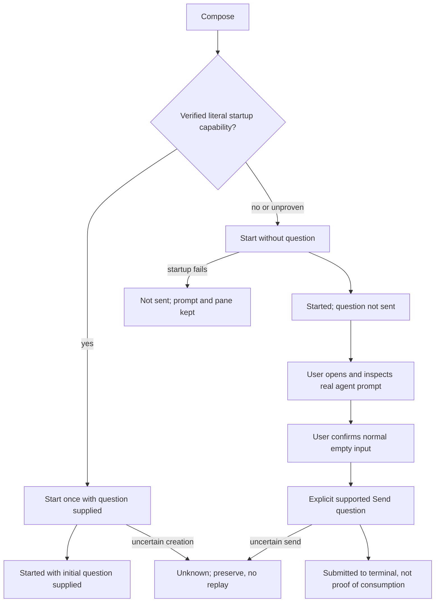

# Quick agent question launcher — UX design

Design only. No product code, tests, configuration or others’ docs changed. Source inspection only: no builds, tests, formatting or runtime verification. Examples are design references, not evidence of working behavior.

**Authority:** Main’s latest root decision supersedes the earlier generic automatic `agent.prompt` model in `PLAN.md`: use documented interactive initial-question argv/stdin only where truly literal; supply startup input once; report **Started with initial question supplied**, never consumption. For unsafe or unproven startup input (notably OMP/Pi `@file` expansion), start without a question, retain it, and require explicit user action after the user verifies the real prompt. **No automatic generic send after a readiness signal.** This file replaces earlier design revisions in place.

## Goal & users

A keyboard-first operator types a question, selects OMP, Pi, Claude Code, Copilot CLI, Codex CLI or OpenCode, and gets an interactive, recoverable, dedicated new pane without registering a supervisor, task, run, credential or orchestration worker.

Protect existing panes and drafts. Keep the composer focused and the new pane unactivated until the initial launch/delivery stage finishes. Never silently rewrite the question, replay uncertain effects, close a retained pane or claim that a model consumed a question merely because a process started.

Users include keyboard-only and screen-reader operators, native/browser users and narrow-window users. Non-goals: in-composer answer streaming, chat history, model/effort/permission settings, attachments, sending into an existing pane, or read-only guarantees unsupported by a harness.

## Evidence (existing patterns reused)

Source-grounded observations, not runtime claims:

| Pattern | Evidence |
| --- | --- |
| Modal dialog, labelled heading, scrim and footer hint | `src/app/shell/QuickSwitcher.tsx:32-33,65`; `src/app/shell/CommandOverlay.tsx:56-68` |
| Esc, focus restoration and Tab trapping | `src/app/input/modal.ts:16-47` |
| Form rows, More disclosure, Cancel/primary footer | `src/app/projects/SetupDialog.tsx:813-860` |
| 600px dialog; stacked rows below 480px | `src/app/projects/taskSetup.css:1-16,35-50,124-160` |
| Reserved footer message slot | `src/app/ErrorSlot.tsx:5-23`; `src/app/errorSlot.css:13-16` |
| Commands disabled reasons | `src/app/shell/commands.ts:11,99-104` |
| Enter newline; Ctrl/Cmd+Enter submits | `docs/keyboard-shortcuts.md:140-141` |
| Closing retains drafts | `docs/keyboard-shortcuts.md:143` |
| Uncertain result: no Retry, inspect terminal | `docs/keyboard-shortcuts.md:9` |
| Herdr popup owns keyboard | `docs/keyboard-shortcuts.md:160-162`; `modal.ts:25` |
| Terminal error/control-loss recovery | `src/app/TerminalPane.tsx:191-209` |
| Space checkout versus optional pane cwd | `src/protocol/generated/v1.ts:262-270` |
| Tab-strip action area | `src/app/shell/TabStrip.tsx:96-97` |
| Existing prefix registry, lowercase t unused | `src/app/input/shortcuts.ts:98-140` |
| Actual semantic colours, type, radii and sizes | `src/app/styles/tokens.css:5-87` |
| Distinct stale/disconnected/failed states | `research/ui-implementation-constraints.md:101-113` |
| Confirmed focus, ownership and persistent process authority | `research/ui-implementation-constraints.md:23-55,75-85` |
| Flat workbench; Agents is not chat; local recovery | `research/ui-design-direction.md:9,110,228-238,283-299` |

Root decision is the authority for the new delivery strategy. Per-harness startup capabilities and consumption are **not established by this source review**. Do not fill an agent capability table with guesses. `PLAN.md`’s old automatic-readiness-send phases/claims must not be used to contradict the root decision.

**Focused recovery correction (2026-10-27):** the rules below supersede earlier clear-on-success and navigation-as-inspection assumptions. Inspected implementation snapshots: `src/app/quickAsk/QuickAskDialog.tsx:83,125-144` already provide retained read-only Question, local status, Open tab and New question, but Send still depends on `inspected`; `src/app/quickAsk/useQuickAsk.ts:105-123,199-222,238-251` introduces separate confirmation and explicit clearing. These are source observations during concurrent implementation, not claims that integration is complete.

## Flow

### 1. Compose

Open **Ask an agent…** in Commands or `Ctrl+B t`. Focus Question. Last-used available agent selected, else first available, else none. Resolve Runs in visibly: Space checkout → selected terminal cwd → explicit absolute existing folder.

The selected agent’s delivery description appears **before commitment**:
- Verified literal interactive startup input: **Starts with your question supplied.**
- Unsafe or unproven startup input: **Starts without your question. You will check the agent’s prompt before sending it.**

This is a capability difference, not a greyed-out agent. All six remain selectable if installed and supported. Never silently use a nonliteral mechanism to make the fast path look available.

### 2. Start

Ctrl/Cmd+Enter or **Start OMP** commits one request identity. Dedicated new pane, exact captured Space/folder. Composer keeps focus during launch; existing panes untouched. Repeated activation is inert.

**Path A — verified literal interactive startup input:** supply question once with the harness startup mechanism. On acknowledged creation, show **Started with initial question supplied**. Do not additionally send through `agent.prompt`, paste, Enter or a hook. A login/trust screen does not authorize Cockpit to replay the question later.

**Path B — no safe literal startup input:** start the interactive harness without question. Show **Started; question not sent**. Preserve the text and offer **Open agent**. No readiness observation, idle status, timer or reconnect ever sends the question automatically.

### 3. Inspect / explicit send

Path B, single-line only: **Open tab** is navigation, not confirmation. User inspects the real terminal, completes startup prompts, checks its normal question input is visible and empty, then reopens the composer. Exact question remains visible and read-only. Native checkbox: **I checked that the agent’s normal question input is visible and empty.** It starts unchecked for every request. Only checking it can authorize **Send question**; click Send explicitly, then run the fresh identity gate. Do not require an additional “inspection complete” dialog or treat an Open tab click as evidence of inspection.

Main confirmed the explicit-send primitive: user verifies the prompt, then **one `agent.prompt` with the identity gate**. Copy question and Open agent remain the manual path. No atomic draft-check claim, raw-keystroke fallback or assertion that manual paste happened.

After explicit send acknowledgment: **Question submitted to the terminal.** No model-processing or answer-consumption claim. Unknown send: stop permanently for this request, preserve prompt/pane, manual recovery only.

#### Minimal recovery state contract

| State/event | Required UI and effect |
| --- | --- |
| Single-line fallback awaiting user | Local status: “Your question has not been sent. Open the tab, finish any startup prompts, and check that the normal question input is visible and empty.” Keep Question read-only. Show Open tab, unchecked confirmation, Close/Don’t send as already supported, and disabled Send question. Helper: “Check the agent’s input, then confirm above to enable Send question.” |
| User checks confirmation | Enable Send only for this request’s unchanged captured question, target and eligible phase, while no action is pending and connection/identity are valid. Checking alone does not send. Unchecking disables Send immediately. |
| Open tab, close/hide composer, request replacement/New question, question/agent/folder/destination change, observed target or eligibility change, stale/disconnected observation, unknown outcome | Clear confirmation immediately; return to unchecked if recovery is still eligible. Reopening/reconnecting never restores consent. Keep the question. Open tab always clears consent before navigating, including when used a second time after confirming. |
| Repeated unchanged status read | Never grants confirmation. Preserve an existing check only while the same request/target/eligible state is demonstrably unchanged; conservatively invalidating on a newer operation status is acceptable. Do not infer anything about unobservable terminal drafts from polling. |
| User activates Send | Consume confirmation and synchronously disable repeat activation before dispatch; at most one effect. No delayed send after reconnect, no automatic recheck after refusal. Target refusal remains not-sent/manual recovery; unknown dispatch has no Send or retry. |
| Multiline fallback | Copy-only: Open tab and Copy question; **omit confirmation and Send**, rather than showing an impossible disabled Send. Copy success is not paste/submission or inspection. Clipboard failure: local “Could not copy the question. Select and copy it from Question.” Preserve selectable text. |
| Submitted / initial question supplied | Keep exact Question visible, read-only and selectable; show the truthful receipt plus “Your question is kept here. New question clears it.” Open tab, Close and New question. No confirmation or active Send/Ask. Closing, auto-switching tabs and reopening keep text and receipt. Only explicit New question clears it and focuses the now-empty Question; it never starts another agent. |

There is no undo for terminal submission. Keeping the draft is not permission to replay it. New question intentionally clears this one in-memory draft; no confirmation modal or new undo system is needed for this focused correction. A full application restart remains outside draft-retention scope.



### Cancellation and uncertainty

| Stage | Control and effect | Copy / retained resources |
| --- | --- | --- |
| Editing | Cancel/Esc closes; memory draft retained | Reopen: Draft restored |
| Preparation before external effect | Cancel truly stops | Nothing was started or sent |
| Path A launch with question dispatched | Stop waiting hides only; launch cannot be recalled | Launch may have started with question supplied; chip tracks result; never say cancelled |
| Path B launching without question | Don’t send prevents any later app send; may hide/leave the startup running | Question not sent. Named pane may remain open; no auto-kill |
| Started without question / awaiting confirmation | Don’t send returns to Editing, text intact | Pane and agent remain; ordinary confirmed close handles stopping |
| Explicit send dispatched | Stop waiting hides only | Cannot undo terminal submission; no second send |
| Started with supplied input / submitted | Close hides only | Does not stop process or erase evidence |
| Unknown effect | Open agent, Copy question, Dismiss after one used | No Retry, Check again proof, resend into same pane, automatic restart or reconstructed consumption claim |

Cancel is not confirmed until the server reports it. If send/launch with input already began, show **Too late to cancel: the request had already been sent.** Follow true status. No compensating kill/close or second request.

Unknown creation is not equivalent to “question not sent” on Path A. A matching tag, idle process or output cannot prove consumption or safe replay. Path B can honestly state the question was not supplied by startup, even if pane creation was uncertain.

## Screens/components

```text
┌ Ask an agent                                      [Close] ┐
│ Agent    [OMP ✓][Pi][Claude Code]                         │
│          [Copilot CLI][Codex CLI][OpenCode]                │
│ Question ┌──────────────────────────────────────────┐    │
│          │ Why does the retry send twice?           │    │
│          └──────────────────────────────────────────┘    │
│          Starts without your question. Check the agent’s │
│          prompt before sending.                           │
│ Runs in  ~/code/api-review · Space checkout   Change…     │
│ ▸ More                                                   │
├─────────────────────────────────────────────────────────┤
│ [reserved status slot]             [Cancel] [Start OMP]  │
└─────────────────────────────────────────────────────────┘
```

| Component/state | Specification |
| --- | --- |
| Dialog | Existing Setup geometry, min(600px, available width), viewport-bounded scrollable body/footer. No decorative card/chat surface. |
| Agent | Native radios; fixed OMP/Pi/Claude Code/Copilot CLI/Codex CLI/OpenCode order. Canonical executable sub-label. Missing host PATH executable disabled with visible “Not found on PATH”; never silently switch a user’s choice. Capability description updates under Question. |
| Question | Plain labelled textarea, min four rows, max 40vh before scroll. No Markdown renderer or attachments. Exact text retained; no implicit trim, quoting rewrite, added leading space, @ expansion or truncation. |
| Byte limit | Retain current planned 16,384-byte core limit only if adapter contract still applies; show UTF-8 counter near threshold. Startup/explicit paths may have different verified safe limits; display actual selected-path limit, never silently truncate. |
| Runs in | Always-visible path and source; Change exposes editable folder. Unresolved: “This Space has no checkout and the selected terminal reported no folder. Enter an absolute path.” Never guess home. |
| More | Switch to new tab after initial stage, default on; “Runs with the agent’s normal permissions.” Delivery summary describes startup input or explicit confirmation; no generic “auto sends once ready”. |
| Path A success | Status “Started with initial question supplied.” Detail “The process has the question. Cockpit has not confirmed that the agent processed it.” Open agent / Close. Do not call this Answered or Consumed. |
| Path B started | Status “Started OMP. Your question has not been sent.” Open agent primary; Copy question; Close. No ready→auto-send transition. |
| Explicit confirmation | Single-line fallback only. Exact question visible; native checkbox “I checked that the agent’s normal question input is visible and empty.” Open tab never checks it. Helper explains disabled Send. Apply the recovery invalidation table above. |
| Explicit submit acknowledged | “Question submitted to the terminal.” Detail “Cockpit has not confirmed that the agent processed it. Your question is kept here. New question clears it.” Read-only retained Question; Open tab / Close / New question. |
| Unknown | “Cockpit couldn’t confirm the outcome. Open the agent before asking again; repeating this request could duplicate your question.” Open agent / Copy question / gated Dismiss. |
| Tab/chip | `Ask · <Agent> · <tag>` without question excerpt. Hidden-operation chip: Starting…, Started — question supplied, Question not sent — open agent, Confirm before sending, Submission unconfirmed. Click reopens state; never reopens or steals focus by itself. |

**Focus after initial stage:** if Switch on and composer still visible, navigate only after known startup outcome. Path B navigation exposes the real prompt to inspect, not permission to send automatically. If composer hidden meanwhile, local status offers Open agent instead of stealing focus.

**Failures and permission states:**
- Availability loading: Checking agents…; no executable: “No supported agent was found on PATH.” No fake installer/settings button.
- No Space/live session: disabled launch with explanatory text. Drafts remain editable offline; reconnect never starts/sends.
- Authentication/trust/permission screen: Open agent; complete it there; retain question, no automatic generic input. Path A status remains supplied-not-consumed rather than retrying it.
- Stale target or readiness/identity change before explicit send: Not sent, preserve prompt/pane, manual recovery. No renaming or retargeting to manufacture proof.
- Environment/capability verification fails, including non-Linux without equivalent verification: fail closed; reason local, no bypass. Name retained pane if one exists.
- Process fails/exits: preserve pane or its launch record and available output. Whether each chosen startup mode retains a shell/closed pane is a **live acceptance requirement**, not assumed from old shell-launch plan.
- Status read fails: keep last confirmed phase and mark observation stale; never infer success/failure/cancellation or resend.

### Validation

No blanket refusal for `/`, `!`, `@` or `-`. If a selected startup mode parses an input as a flag/file instead of literal text, choose Path B rather than mutate or ban the question. NUL/control/newline restrictions depend on the actual selected delivery contract. Terminal-input path rejects ESC, CR, unsafe C0/DEL/C1 and unproven multiline to avoid keystroke/submission injection; safe startup stdin may have different constraints. Core remains authoritative; client mirrors the path’s actual rule with a visible explanation.

Refusal example: **Line 2, column 5 holds a character this delivery method can’t safely send.** Explicit optional **Remove control characters** / **Join lines** edits are allowed only with visible result and undo. No silent edits. Over-limit: **Too long for this delivery method. Shorten it.**

Startup argv can expose the prompt in process metadata. If selected, disclose in More: **This launch method supplies your question as a command-line argument; it may be visible in local process information.** Do not claim the prompt is absent from process listings across every harness. Prefer verified literal stdin when supported; never invent undocumented stdin behavior.

## Interaction & keyboard

Entry: Commands primary Navigate action **Ask an agent…** and registry-driven `Ctrl+B t`. Optional tab-strip launcher uses existing comment icon (`UiIcon.tsx:27`), but Commands/prefix first avoids extra chrome. One active composer per window; reopening resumes it rather than launching another.

Initial focus Question. DOM order: Close → agent group → Question/helper → confirmation checkbox when applicable → folder/More → secondary actions → primary. Tab/Shift+Tab trapped; radio arrows native. Enter/Shift+Enter in Question insert newline. Preserve the existing shortcut contract: Ctrl/Cmd+Enter starts only in Editing (`QuickAskDialog.tsx:98-101`), **not** recovery Send. Tab to the checkbox, Space toggles it, then Tab to Send and Enter/Space activates the native button. Repeated keydown/double-click is guarded synchronously before network work. During IME composition Enter/Esc/submit cannot activate anything.

On recovery reopen focus the read-only Question (or dialog heading), never the checkbox or Send automatically; keep all controls in the existing modal trap. If Send loses eligibility while focused, move focus to the confirmation checkbox when available, otherwise the local status/container, without navigating to a terminal.

Esc acts per phase cancellation table, never leaks to terminal. Workbench prefix/quick switcher inactive while modal owns focus. Scrim click never dismisses an active or nonempty composer. Closing restores eligible opener unless confirmed explicit navigation has superseded it.

**Required helper adjustment:** `modal.ts:3` does not include textarea in FOCUSABLE; both initial query and Tab trap skip it. Add `textarea:not(:disabled)` and explicitly focus Question. Existing Esc handler must call current phase-aware action rather than unconditional close.

**External concurrency limitation:** a fresh exact target check and user confirmation do not make terminal input atomic against another client. Herdr has no compare-and-send or supported draft-read API. Stop on observed identity/state changes; never claim arbitrary external draft detection. Dedicated panes and retained composer focus protect existing work; no guarantee against unobservable external mutation. No readiness signal is sufficient for automatic generic input.

**Restart:** no durable secret-bearing draft registry. After a full restart, the pane/tab remains if the runtime retained it; client draft/status may not. Never reconstruct “processed” or “not sent” from a tag or generic agent state. Never replay startup input on restore.

## Accessibility

- Labelled modal dialog; background inert; phase-correct named Close action.
- Native labelled radio group with unavailable reason in accessible name and visible text.
- Explicit textarea label and described-by hint/error; aria-invalid on refusal. Counter not announced on every keystroke.
- One replaced-text phase live region: polite progress/success, alert for action-required failure/unknown. Do not announce terminal output or repeat polling messages.
- Confirmation checkbox is native, keyboard reachable, full visible label clickable, and never prechecked/remembered. Associate its helper with the checkbox and Send using `aria-describedby`; disabled-button explanation remains visible and readable without focusing the disabled button. Announce invalidation once via the existing polite status slot: “Confirmation cleared. Check the agent’s input again before sending.” Unknown/failure retains existing alert treatment. Do not add a second live region, toast or shifting banner.
- Selection uses check glyph/border/fill; status icon + words, never colour only. Real semantic tokens; actual contrast verified by implementation, not claimed from source inspection alone.
- Existing 28px hit target minimum; agent choices at least 36px. Full pointer/keyboard parity for open/copy/cancel/explicit send.
- 2px focus-visible ring; reduced-motion static progress indicator.
- ≤480px stack labels, use two agent columns, status above footer buttons. Scroll body, wrap error paths; no page horizontal scroll at 320px/zoom.

Recovery layout reuses existing dialog rows, typography, focus styles and footer. Place confirmation directly after the retained Question/helper, before secondary actions; its label wraps naturally on narrow viewports. At 320px/zoom, keep Question scrollable/selectable and wrap footer actions without clipping labels or introducing horizontal scroll. Disabled and checked state need native semantics plus text, not colour alone; implementation owns contrast verification.

## Options considered

| Choice | Alternatives | Recommendation / tradeoff |
| --- | --- | --- |
| Delivery | Generic auto-send after readiness; startup-supplied question; always manual | Root-selected capability-based startup input where truly literal, explicit verified-prompt action otherwise. Avoids false-readiness injection; inconsistent per-agent speed is disclosed rather than hidden. |
| Unsafe startup input | Escape/rewrite/banning @ or leading dash; start without input | Start without input, preserve exact question; user confirms prompt before explicit send. More steps but honest literal semantics. |
| Status | Started/Consumed conflation; supplied-not-consumed distinction | Distinguish startup supplied, explicit terminal submitted, agent processed (unobserved). More words, fewer false promises. |
| Surface | Modal, docked chat, palette text | Modal reuses ownership/Esc and multiline; hides terminal while drafting. Docked chat competes with workbench; palette lacks recovery space. |
| Destination | Existing pane, split, dedicated tab, popup | Dedicated recoverable tab protects existing drafts; costs a tab per ask. |
| Submit key | Enter, Ctrl/Cmd+Enter, button only | Ctrl/Cmd+Enter aligns existing composers and avoids newline/IME accidental launch. |
| Cancellation | Kill/close, claim abort, stop-waiting | Never auto-kill/close; distinguish pre-effect cancellation and post-effect hide. Leaves resources for deliberate confirmed closure. |
| Unknown recovery | Retry/check proof/manual inspect | Manual Open/Copy/Dismiss, no replay. Operator work is the cost of honest uncertainty. |
| Agent selector | Radios/native select/six palette rows | Six radios expose capability/availability; select denser but hides choices, separate actions clutter Commands. |
| Draft retention | Clear on success; retain in memory until explicit New question; disk history | Retain exact text in window memory across every receipt and ordinary close/reopen. Only New question clears after success. No disk history or implicit resend; supersedes the previous clear-on-success recommendation. |
| Confirmation | Open tab enables Send; checkbox alone; extra confirmation dialog | Separate native checkbox attesting actual visible empty normal input, then explicit Send. Navigation is not authorization; a second dialog adds no stronger evidence and increases keyboard cost. |
| Consent lifetime | Persist until request finishes; invalidate on leaving/relevant change | Invalidate on leaving composer and any relevant request/target/eligibility/connection change. One extra check after navigation is preferable to stale consent; no new timer or terminal draft detector. |

## Open questions (options + recommended default)

1. **Per-harness verified capability table:** which interactive startup argv/stdin path is truly literal, and its size/newline rules? Product-research/implementation-owned evidence required; **default unproven → launch without question**, not a guessed fast path. OMP/Pi @file expansion makes generic positional startup unsafe.
2. **Explicit send primitive — resolved by Main:** user verification then one identity-gated `agent.prompt`, plus Copy/manual path. Not an open implementation choice.
3. **Privacy disclosure:** always-visible argv warning versus More. Recommend capability summary visible, detailed argv exposure warning in More. Never store prompt in labels/logs/errors.
4. **Recovery after direct-command exit:** persistent closed pane, shell wrapper supported by runtime, or retained launch record. Recommend runtime-native retention, no improvised interpolation wrapper; verify each actual startup path.
5. **Tab-strip launcher:** recommend Commands + prefix initially; status chip still required.
6. **Recent/reuse prompt row:** recommend optional single memory entry at most, no disk history/task surface. Not necessary for pane recovery.
7. **Close retained tab shortcut:** recommend normal existing confirmation if exact-location targeting is supported; otherwise guidance, no auto-close.
8. **Unsupported host early gate:** recommend refuse before creating an empty tab where host capability absence is knowable, keeping fail-closed semantics everywhere.
9. **Proof of model processing:** no inference from spawn, idle, output or ACK; recommend do not add consumption UI until a harness provides an authoritative receipt.
10. **Draft discard undo:** retain an undo buffer versus explicit New question without undo. **Recommended default for this correction:** the visibly labelled New question is the sole clear operation; no extra modal or persistence. If product later requires discard undo, specify it separately rather than changing submission recovery.

## Acceptance scenarios (observable checks for Main)

Future requested checks, not verification exercised in this design pass:

1. Commands/shortcut opens composer with Question focused; typing never reaches old/new panes. Existing drafts remain unchanged.
2. Capability description precedes commitment. Unsafe/unproven startup agent remains selectable but says starts without question.
3. Verified startup path supplies literal text once; repeated launch activation produces one process. No second agent.prompt/hook/Enter after startup, including delayed readiness/login.
4. Startup success reads **Started with initial question supplied**, never “agent processed/consumed/answered”.
5. OMP/Pi @file and leading-option edge cases choose no-question startup rather than expansion, rewriting or blanket input prohibition.
6. No-question path retains prompt; startup blocked/unblocked, idle, reconnect and time passing never send automatically.
7. Single-line fallback: Open tab, automatic navigation, Copy, idle, unchanged polling and reopening alone leave Send disabled. User can explicitly check “I checked that the agent’s normal question input is visible and empty.” then activate Send once. Checkbox alone sends nothing; keyboard and pointer reach the same result.
8. Confirm, then Open tab/close/reopen/change request or target/disconnect/lose eligibility: check clears and Send disables; reconnect never restores it. Explicit send consumes the check before network work. A newer unchanged status may conservatively clear consent but never grant it.
9. Startup with input timeout may have supplied it; UI never says definitely not sent or repeats launch. No-input startup timeout states only the proven fact that startup did not carry a question.
10. Pre-effect cancel versus in-flight Stop waiting produces correct copy; no auto-close, kill, hidden compensation or late focus steal.
11. Fail-closed environment/capability check applies on every host; no private fixture-token copy or bypass. No orchestration registration/credentials leak.
12. Exact whitespace, quotes, dollar signs, backslashes and permitted multiline stay literal under each actual chosen path; refusal is explicit and never silently normalizes.
13. Normal launch outcome with Switch on and visible composer activates pane only after initial stage; hidden operation shows local Open instead. Blocked/manual inspection opens only by user action.
14. Real runtime preserves recoverable pane/output across composer close, Cockpit reconnect and agent exit; no automatic replay on restart.
15. Keyboard/IME/screen-reader flow handles confirmation, copy/open/cancel; textarea is in Tab trap. Narrow/zoom and reduced motion remain usable.
16. Submitted and initial-question-supplied receipts retain the exact text, including trailing LF, through Close/auto-switch/Open tab/reopen. No active Send/Ask appears. New question alone clears it, focuses empty Question, and makes no launch call.
17. Multiline fallback exposes Open tab and Copy but no checkbox/Send. Clipboard failure stays local and preserves selectable text. Copy success never claims paste or submission.
18. Screen reader announces checkbox label, helper and checked state; invalidation is announced once. Disabled Send reason is readable. Tab/Shift+Tab remain trapped, Space toggles checkbox, native Enter/Space activates Send; Ctrl/Cmd+Enter does not send from recovery. Narrow/zoom footer and wrapped confirmation remain readable.

## Examples

- `planning/quick-agent-question-2026-10-26/mocks/ask-composer.html` — existing standalone gallery using real copied tokens; visual geometry reference only. Its older confirmation copy and multiline recovery illustration are superseded by the minimal recovery state contract above. No backend actions or verification claims.
