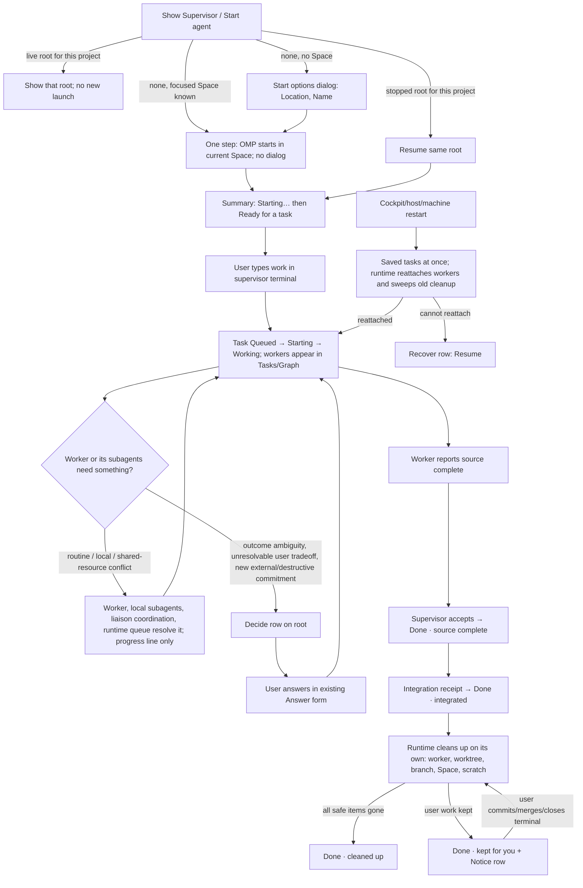

# Supervisor liaison — interaction and state spec (UX)

Status: planning only. Nothing here is implemented or runtime-exercised. Existing behavior cites repository evidence read on 2026-10-10; unobserved claims are marked `[INFERENCE]`. [PLAN.md](PLAN.md) owns the proposed contracts: model-independent idempotent resume; replaceable execution attachment; Queued / Starting / Working / Review / Done without grant gates; mutable task scope and instruction delivery to the same worker; independent integration and cleanup facts. The required integration record retains the accepted-output-to-target mapping, target reference/commit, method (`ancestor`, `patch_equivalent`, or `recorded_adaptation`), and changed-contract verification outcome. For `recorded_adaptation`, the integrator explicitly supplies a verified mapping; runtime reconciliation validates that record rather than inferring integration from source acceptance or a target commit. `not_applicable` is for non-code deliverables, not borrowed coding checkouts. Branch/worktree deletion requires the validated integrated output and no additional dirty/unmerged work. Cleanup items distinguish worker/worktree/branch/Space/scratch and owned fixture sets; optional `CleanupFinish` retries the same runtime-owned operation. All product decisions are made in §8; these are proposals, not existing APIs.

## 1. Goal & users

Make the supervisor a liaison the user starts in one action, gives work to in the terminal they already use, and sees outcomes from, without approving routine steps, repairing bindings after a restart, or running cleanup by hand.

User: one developer working across projects in Cockpit (dashboard primarily observational, DECISIONS product direction).

Happy path with no confirmation dialog, no hash, no native-session id, no receipt text:
1. Show or Start the supervisor in the current project.
2. Type the work into the supervisor terminal.
3. Workers appear, work, finish; the task goes Done.
4. Worker terminals, owned Spaces, worktrees and scratch are removed by the runtime without the user.
5. After a reboot/restart the same tasks and workers resume.

Non-goals: no bottom composer, no new dashboard, no new view, no new top-bar button, no new keyboard shortcut, no build/queue surface. Tasks / Graph / Dependencies and terminal input stay as they are.

## 2. Evidence (existing patterns reused)

| Fact | Source |
|---|---|
| Tasks default; Graph and Dependencies are peers; "Give work in the supervisor terminal; the dashboard explains progress and exposes decisions and guarded recovery" | `docs/supervisor-surfaces.md:7` |
| Bottom Task composer, assignment notice, Other-agents filter, unmanaged overview, no-agent paragraph, Start-agent focus tooltip are intentionally removed | `docs/supervisor-surfaces.md:19` |
| Lanes Queued, Preparing, Ready, Working, Review, collapsed Done (core `accepted`); failed-report text literal; ordinary successful report bodies in details | `docs/supervisor-surfaces.md:11`, lane render `src/app/supervisor/supervisorViewWorkarea.tsx:20-25` |
| Routine Prepare, Execute, Result acceptance and worker NeedsInput are already supervisor-owned and excluded from user counters | `docs/supervisor-surfaces.md:12`, `src/app/supervisor/attention.ts:47-54` |
| Entry points: top-bar "Supervisor" toggle; Commands "Show Supervisor" and "Start agent"; both keyless; Start does not move terminal focus | `src/app/shell/TabStrip.tsx:78`, `src/app/shell/commands.ts:87-88`, `src/app/input/shortcuts.ts:132-133` |
| Start already runs in one step in the focused Space; dialog opens only when no destination | `src/app/supervisor/useStartAgentFlow.ts:30-40`, destination = focused Space `src/app/supervisor/supervisorViewModel.ts:16` |
| Start action is `supervisor_start` with `existing_space`; focus returns to the invoker once OMP is verified | `useStartAgentFlow.ts:36,42-45` |
| Start dialog has Name, Location (Existing Space / Directory / Dedicated folder), Space | `src/app/supervisor/SupervisorDialogs.tsx:15,152-162` |
| Restart is a ladder: reconcile → setup-recovery dialog / retry dialog ("could leave another agent running") | `useStartAgentFlow.ts:46-62`, `SupervisorDialogs.tsx:163-171,178-180` |
| Recovery actions: Check status, Open terminal, Restart agent…, Close tracking… with reasons via `aria-describedby` | `src/app/supervisor/SupervisorActions.tsx:122-145,196-224` |
| Agent state labels ("Starting agent…", "Preparing · OMP connected", "Cannot confirm the agent", "Agent terminal is gone", "Connection lost", "Managing tasks", "Ready for a task") | `SupervisorActions.tsx:13-44` |
| Offline/stale banner "Connection lost · showing saved tasks · agent may still be running" | `supervisorViewModel.ts:41` |
| Task status strings | `SupervisorActions.tsx:55-68` |
| Prepare/Execute override: exact plan, armed "Confirm … override", disarmed on plan change; under collapsed "Operator intervention — normally handled by the supervisor" | `SupervisorActions.tsx:225-253,390-412` |
| Existing **Follow-up to agent** TextAction: `message_send` instruction, durable operation id, retained draft, "Retry same message" | `SupervisorActions.tsx:165-195,364` |
| Progress trail "Prepared · by supervisor", "Executing", "Accepted" | `SupervisorActions.tsx:97-108` |
| Accepted-worker retirement states/reasons; retained → Notice, unknown → Recover | `src/app/supervisor/retirementView.ts:5-70`, `attention.ts:51` |
| Space teardown dialog (Checkout / Ownership / Git status, blockers, Close Space / Remove task worktree / Reconcile removal, typed `REMOVE <path>`); Space menu "Review task cleanup…"; Commands "Recover task cleanup…"; "Pending cleanup" panel | `src/app/projects/TeardownDialog.tsx:30-35,96-112`, `src/app/shell/ResourceContextMenu.tsx:21`, `src/app/shell/commands.ts:114`, `src/app/projects/TeardownRecoveryPanel.tsx:25-28,68` |
| Terminal navigation explicit, identity-fenced; viewing/selecting never focuses a terminal | `src/app/shell/useSupervisorNavigation.ts:13-27`, `docs/supervisor-surfaces.md:19` |
| Drafts root-scoped; polling, delayed launch, root change never steal focus or discard drafts; dialogs trap Tab, Escape closes, focus returns to invoker | `docs/supervisor-surfaces.md:63`, `SupervisorDialogs.tsx:68-113` |
| Agent selector appears only with more than one open root (multiple roots allowed) | `src/app/supervisor/supervisorViewSurface.tsx:30` |
| Hierarchical task steps, native checkboxes, leaf-derived progress | `docs/supervisor-surfaces.md:21` |
| Internal OMP subagents shown as secondary no-pane children | `docs/supervisor-surfaces.md` surface index "Internal OMP subagents" |
| Retro direction | `docs/retrospectives/2026-10-10-cleanup-orchestration.md` findings 1–6, "Recommended direction" |

## 3. Flow



## 4. Screens / components

Footprint: reuse Summary strip, queue rows, task cards, Overview/Actions panels, Teardown dialogs. Net new: one cleanup suffix on completed cards; one "Cleanup" group in Overview; action labels **Resume** and **Finish cleanup**; one Commands entry **Start another agent…**. No new text area, lane, view or surface.

### 4.1 Show / Start / Resume (Summary strip + empty state)

One primary action slot in the existing Summary shortcut position (`supervisorViewSurface.tsx:44`, today only Open terminal). Its label derives from the selected root; the user does not choose it:

| Root state | Primary action | Behavior |
|---|---|---|
| No open root for this project | **Start agent** (empty state `supervisorViewSurface.tsx:47`; Commands "Start agent") | `supervisor_start` in focused Space, no dialog. Dialog only when no destination (`useStartAgentFlow.ts:32`). |
| Open root, OMP connected | **Open terminal** | Existing explicit navigation. |
| Open root, saved record intact, not live (restart, terminal gone, unconfirmed launch) | **Resume** | One call to `run resume`. Reattaches or starts a new incarnation in the same Space/checkout. No confirmation dialog, no Check-status step. Replaces "Check status" + "Restart agent…" in the happy path. |

Start rules (decided):
- **Start agent / Show Supervisor reuse the root.** If a live root exists for the same project, Start agent selects and shows it (the currently selected root if it matches; otherwise the most recently active) and launches nothing. Status line `Supervisor already running · <project>`; focus unchanged. If the project's root exists but is stopped, Start agent resumes that same root (same as **Resume**). A new root is created only when no root exists for the project.
- **Start another agent…** (new Commands entry, keyless) always creates a distinct root. It opens the existing Start options dialog (Name, Location) because a second root needs a name or location to be distinguishable; submit = `supervisor_start`. Multiple roots stay allowed; the Agent selector appears at >1 open root (`supervisorViewSurface.tsx:30`) and each root resolves its own primary action.
- "Same project" is the root's recorded Space/project matched against the focused Space `[INFERENCE: matching key is a repository/project key owned by PLAN; the UI only asks the host for "root for this project"]`.

Summary status (replaces `agentState` labels at `SupervisorActions.tsx:23-43` where noted; no model, session id, endpoint or hash text):

| State | Label | Glyph / tier |
|---|---|---|
| Launching | **Starting…** | unknown glyph, none |
| Reattaching after restart (PLAN `resuming`) | **Resuming…** (replaces "Cannot confirm the agent" while reattach is in progress) | unknown glyph, none |
| OMP connected | **Ready for a task** / **Managing tasks** (unchanged) | live |
| Cockpit↔Herdr link down | **Connection lost** + existing banner (unchanged, `supervisorViewModel.ts:41`) | muted |
| Resume failed | **Can't resume** + cause + **Resume** | Recover |

Restart banner (existing banner slot): `Restored from saved tasks · reconnecting agents (2 of 4)`; when the runtime is also sweeping old cleanup it appends ` · finishing cleanup for 3 tasks`. Counts come from PLAN `reattach` and `cleanup` records. It clears itself without a toast. Tasks, Graph, Dependencies render from saved state immediately.

Removed from the happy path: the Restart agent dialog (`SupervisorDialogs.tsx:163-165`), "Check again first", "Restart anyway", "Check status" as a routine step.

**Duplicate-writer dialog** (only reachable from a Decide row for a genuine competing-writer tradeoff that runtime/liaison cannot resolve). A recognized living managed worker normally reattaches automatically; mere liveness does not trigger this dialog.

- Title **Another agent is still running here**. Body: `<Task or supervisor label> already has a running agent in this checkout. Replace stops it first, then continues from its saved work. Nothing runs twice.`
- Buttons: **Keep existing** (default focus, safe) and **Replace existing**. There is no "Start new" label and no "Restart anyway".
- **Replace existing** is a safe handover, not an override: the runtime asks the old writer to stop and waits for quiescence; only then does the new incarnation take the checkout. The dialog shows `Stopping the existing agent…` (status), then `Resumed` and closes. It never forces past a lock, lease/CAS or timeout.
- If the old agent cannot be quiesced (busy, unreachable, unsent terminal draft), the dialog stays open or returns to the Decide row with `Existing agent kept · <reason>`; nothing is replaced. Unsent terminal text is never cleared.
- Keyboard: Escape = Keep existing. Tab trap, focus return per existing dialog pattern (`SupervisorDialogs.tsx:68-113`).

### 4.2 Giving work

Unchanged: the user types into the supervisor terminal. Empty Tasks state stays `No tasks yet` + **Open terminal** (`supervisorViewWorkarea.tsx:72-75`); no explanatory paragraph, no composer. The supervisor creates tasks; a task is started at task level without a user step. A batch of small slices appears as one task with its existing step checklist (`docs/supervisor-surfaces.md:21`), not one card/worker per slice, unless the supervisor assigns independent workers.

### 4.3 Spawned workers, local autonomy and routine gates

Lane labels follow the PLAN lanes. No Ready or approval lane exists; initialization readiness is runtime status only.

| Lane | Meaning | Notes |
|---|---|---|
| Queued | not started, or waiting for a worker slot | unchanged lane; a slot wait is only the card status `Queued · waiting for a worker slot` (text, no queue surface) |
| Starting | worker launching, connecting, reading brief | replaces Preparing and Ready; readiness shows as the card's status line `Starting · connecting` (the runtime status already labeled "Preparing · OMP connected", `SupervisorActions.tsx:40`), not as a gate |
| Working | worker active | unchanged |
| Review | worker reported source complete; supervisor accepting | status `Source complete · awaiting acceptance` |
| Done | accepted; collapsed disclosure | §4.5 |

There is no Scoping lane. A task whose location or scope is unknown is resolved by the liaison; if only the user can resolve it, it raises a Decide row (below), not a lane.

Rules:
- No Prepare, Execute, Result-acceptance, verification-approval, slot or ACK prompt reaches the user. `awaits_prepare`/`awaits_execute`/`to_accept` are already excluded (`attention.ts:50`); PLAN removes `AwaitsPrepare`, `AwaitsExecute`, `PlanChanged`, `BriefUnread` attention outright.
- Workers own implementation, local subagents, command choice and affected verification. Their subagents' questions, reviews and delegation stay in worker/subagent detail (existing secondary Internal subagent rows); they never raise a user row.
- **Decide** appears on the root only for: (a) an outcome ambiguity that changes what the user asked for; (b) a tradeoff between competing user goals that the liaison cannot resolve; (c) a new external commitment or a destructive action outside standing authority. Shared file/checkout/compiler contention and other resource conflicts are coordinated by the liaison and runtime queue; they appear at most as the worker's latest progress line (`waiting for <other task>`), never as a row, lane, counter or queue surface. Decide copy shows the question verbatim with the existing Answer form and receipt wording (`SupervisorActions.tsx:48-53,154-163`).
- Progress is coalesced: each card and Overview show one **latest progress** line replaced in place with the existing provenance pair (`SupervisorActions.tsx:80-96`). Activity records coalesced batches. Delivery stages (stored/woken/read/acked) appear only inside the question receipt in details; routine ACK and unread-brief states are Diagnostics-only. `idle_without_report` becomes a Notice only after the runtime's automatic nudge fails.
- Progress trail: `Assigned → Started → Source complete → Done`; drop "Prepared · by supervisor/by you" (`SupervisorActions.tsx:103`).
- **Plans are mutable and advisory; no Amend-scope UI.** The armed exact-plan **Prepare/Execute override** (`SupervisorActions.tsx:225-253,404-407`) is deleted. Scope changes use the existing **Follow-up to agent** form (`SupervisorActions.tsx:164`): same textarea, same Send button, same retained draft and "Retry same message" operation identity. On Send the host updates the canonical task description (a root/operator `TaskUpdate`, allowed while Working) and automatically delivers the Update instruction to the same worker: same actor, no grant, no plan revision to review, no replacement worker. Only copy changes: success text `Update sent · task description updated`; failure copy unchanged (an unconfirmed update keeps its operation identity per the existing unknown-write rules, `docs/supervisor-surfaces.md:22`). Under Activity the current scope is shown read-only as **Scope** (was "Work plan", `SupervisorActions.tsx:350`); the card shows `scope updated 3m ago`. `plan_changed` is no longer a user Notice. The follow-up form is available while the run is not closed and live (`SupervisorActions.tsx:300`).
- Advanced inspection stays: the collapsed section is renamed **Advanced** (was "Operator intervention — normally handled by the supervisor", `SupervisorActions.tsx:394`) with Accept explicit result, Send back, Close agent tracking…, and Diagnostics (exact plans, native sessions, delivery records, receipts, hashes). Opening it grants nothing.
- Verification is proportional and invisible as a gate: size and function-length metrics are advisory and never block or appear as acceptance state. Real compiler or test failures that affect the change stay meaningful: they appear as the worker's literal failed-report text (existing behavior, `docs/supervisor-surfaces.md:11`) or in its Result, and the worker decides source-complete from them. No verification-approval, build-slot or proof-project surface exists.

### 4.4 Reconnecting after restart

State order seen by the user: saved tasks immediately → banner `Restored from saved tasks · reconnecting agents (n of m)` → each worker card `Resuming…` → previous state (`Working`, etc.) → banner clears.

- The runtime reattaches workers and sweeps historical cleanup on its own; it does not depend on the supervisor model. Root shows `Resuming…`, not "Waiting for supervisor" (`SupervisorActions.tsx:27`), until OMP is connected.
- Worker cards keep task identity, checkout and last progress; no "stranded", "Agent terminal is gone" or "Cannot confirm the agent" while PLAN `reattach` is in progress.
- After automatic recovery cannot proceed, distinguish causes: unknown outcome, checkout changes or Herdr unavailability produce one **Recover** row with **Resume**, **Open terminal** (when present), and **Show in Tasks**. A genuine competing live writer requiring a user Keep/Replace choice produces **Decide** and the safe-handover dialog. A recognized living managed worker reattaches without either row. Causes use plain text, not PIDs or hashes.
- Cockpit↔Herdr loss keeps the existing "Connection lost" semantics and is not described as an agent failure.
- No duplicates: while Resume is in flight the button reads `Resuming…` and is disabled with the existing reason pattern (`startLock`, `useStartAgentFlow.ts:31`).

### 4.5 Completion and cleanup (independent axes)

A completed task shows two independent facts, never one merged badge:

1. **Outcome** (PLAN integration fact, required): `Source complete` (worker Result succeeded; Review lane until accepted; Done once accepted) → `Integrated` (validated integration record). Overview names the method in plain words: `in main` (ancestor), `equivalent patch in main` (patch equivalence), `adapted — recorded` (explicit integrator-verified output mapping), with the target branch. `pending` reads `waiting for integration`. `not_applicable` is only for a non-code deliverable, such as research—not a coding task in a borrowed directory. It shows Outcome `Done` without integration wording. Any new source added after the recorded output remains protected.
2. **Cleanup** (PLAN `cleanup` record), run by the runtime without user action.

Done card status line (extends `taskStatus`, `SupervisorActions.tsx:55-68`):

| Cleanup state | Card suffix | Tier |
|---|---|---|
| Running | `Done · cleaning up…` | none |
| Waiting on something transient (worker busy, Herdr not answering, sub-runs open) | `Done · cleanup waiting` | none; runtime retries |
| Waiting for integration (work still only on its branch/worktree) | `Done · worktree waiting for integration` | none; removed automatically once the integration receipt appears |
| Reconciling (identity drift, stale endpoint receipt, missing Space after reboot) | `Done · cleanup reconnecting` | none; runtime reconciles on its own |
| All safe resources gone | `Done · cleaned up` | none |
| Kept because of user work | `Done · kept: <reason>` | Notice |
| Automatic cleanup stalled after the runtime's attempts | `Done · cleanup stalled` | Notice; **Finish cleanup** |
| Outcome unknown after a retry | `Done · cleanup not confirmed` | Recover |

Reason table (PLAN class → UI; copy plain, no ids):

| Class | Source reasons | Shown as | Notice? | User action |
|---|---|---|---|---|
| `transient` | busy / pending_messages / async_jobs / live_subagents, waiting blockers, observation_unavailable, worker_busy_timeout, worker_unresponsive, herdr_refused | `cleanup waiting · worker still busy` etc. | no | none; optional **Finish cleanup** (retry now) in details |
| `reconcilable` | identity_incomplete, identity_changed, endpoint_changed, native_process_unverifiable, process_pane_mismatch, native_refused; teardown "pending"/"outcome unknown"; missing Space / reboot / stale endpoint receipt | `cleanup reconnecting` | no, until stalled | none; optional **Finish cleanup** |
| `user_work` | editor_draft, user_activity, shared_tab, tab_renamed, pane_moved, foreground_process; dirty worktree; unmerged commits; borrowed checkout; Space with other terminals | `kept: unsent text in its terminal`, `kept: uncommitted changes`, `kept: 2 commits not merged`, `kept: your directory (borrowed)`, `kept: other terminals in this tab` | yes (status, not alert) | **Open terminal** / **Show in Tasks**; the runtime re-checks on its own after the user acts, and **Finish cleanup** forces that re-check now |

Rules:
- The cleanup owner runs proactively: at accept, at startup, after reconnect and when a kept reason clears. Historical identity drift never requires the user to press anything. **Finish cleanup** is an optional manual retry of that same runtime operation (PLAN `CleanupFinish`), never a required step and never the way a normal task completes.
- Retained user work is not a failure: `role="status"`, no warning glyph, no Recover tier. Only an unknown outcome (`native_stop` / `terminal_close` unknown, `retirement_unconfirmed`) is Recover (`retirementView.ts:39-42`, `attention.ts:51`).
- Overview → **Cleanup** group replaces the paragraph at `SupervisorActions.tsx:313-314`. One row per item, each `Removed` / `Waiting — <reason>` / `Kept — <reason>`: **Worker terminal**, **Task worktree**, **Branch**, **Space**, **Scratch**. Retiring the worker and removing resources are separate rows because they succeed or fail independently.
- **Finish cleanup** is idempotent, has no typed confirmation and no per-resource choice. It re-evaluates every item, removes what is now safe (clean + integrated + Cockpit-owned), and leaves dirty, unmerged, drafted, borrowed and foreign items. Result line: `Cleanup finished` or `Cleanup finished · kept: <reason>`. It never types into a terminal, clears a draft, or force-removes. It replaces "Reconcile removal" and manual-repair wording.
- Placement: queue-row action for a stalled/`user_work` row (existing action group, `SupervisorAttention.test.tsx:112-121` pattern), Overview → Cleanup group, Actions → Routine. Commands "Recover task cleanup…" (`commands.ts:114`) becomes **Finish task cleanup** (optional; runs the same operation over every pending record, no dialog, announces the summary line).
- Advanced, user-initiated removal stays: Space menu **Review task cleanup…** (`ResourceContextMenu.tsx:21`) keeps the TeardownDialog and its typed `REMOVE <path>` confirmation, because it is a user-initiated destructive action. The "Pending cleanup" panel (`TeardownRecoveryPanel.tsx:68`) becomes a read-only inspection list; its rows read `Cleanup reconnecting` / `Cleanup not confirmed` instead of "Removal dispatch needs reconciliation" / "Removal outcome unknown" and offer **Finish cleanup**.
- The Done disclosure stays collapsed (`supervisorViewWorkarea.tsx:22`); its header adds ` · N kept` only when N>0. A Notice row's **Show in Tasks** expands Done and reveals the card with existing minimal reveal (`reveal.ts`); polling never expands it.
- Graph keeps omitting completed tasks; its completed-count line adds `· N kept` when N>0 `[INFERENCE: Graph omits closed runs, so retained workers have no node]`.

## 5. Interaction & keyboard

- No new shortcuts. Show Supervisor, Start agent and the new **Start another agent…** are keyless Commands (`shortcuts.ts:132-133` pattern). Tasks/Graph/Dependencies arrow/Enter/Space behavior unchanged (`docs/supervisor-surfaces.md:33`).
- Start/Resume from Commands or the Summary button never move terminal focus; when OMP is verified and focus is still on the invoker, focus goes to the first task or the primary action (existing `focusTaskOrStart`, `useStartAgentFlow.ts:42-45`). If the user moved focus, nothing moves.
- Automatic events (reattach completes, cleanup finishes, kept row appears, banner clears) never move focus, scroll, expand disclosures or change the selected task. They update text in place.
- Disabled actions use `aria-disabled` + `aria-describedby` reason (`SupervisorActions.tsx:210-218`). Busy locks block double submit.
- After **Finish cleanup** / **Resume** / follow-up Send: focus stays on the button and its outcome appears in the adjacent status region. If the button disappears (resource removed, root resumed), focus moves to the nearest surviving row using the existing removed-node rule (`useDetailFocus.ts:138-139`) and notice.
- Drafts: answer, follow-up/update, note, send-back drafts are root/task-scoped and survive Resume, reconnect, cleanup, root switch, hide/return, offline (existing). Terminal editor text is never touched: cleanup waits or keeps with `kept: unsent text in its terminal`; replace-handover refuses while such text exists.
- Escape closes the topmost dialog/overlay; Escape in a textarea is not consumed. Duplicate-writer dialog: Escape = Keep existing.
- Narrow/short windows: no new layout. Cleanup suffix truncates after the label with a title; Overview Cleanup group is a plain stacked list; queue overlay unchanged (`docs/supervisor-surfaces.md:14,17`).

## 6. Accessibility

- One polite `role="status"` region in the Supervisor view carries coalesced announcements: `Resuming…`, `Supervisor connected`, `Supervisor already running`, `Cleanup finished`, `Cleanup finished · kept: …`, `Update sent · task description updated`. At most one announcement per state-change batch; routine progress lines are not announced.
- `role="alert"` only for Recover rows and failed user-initiated actions (`SupervisorActions.tsx:205`). Kept user work, cleanup waiting/reconnecting and the duplicate-writer `Stopping the existing agent…` progress are status.
- Every status has text; glyphs are decorative or labeled (`StateGlyph`). Outcome and Cleanup are separate text segments with separate accessible names: `Outcome: Done, integrated` and `Cleanup: kept — 2 commits not merged`.
- Cleanup group is a labeled list (`aria-label="Cleanup"`), each row exposes item + state in text.
- Verb-labelled buttons (`Start agent`, `Resume`, `Finish cleanup`, `Open terminal`, `Keep existing`, `Replace existing`); no icon-only actions for these.
- Reuse existing classes (`supervisor-primary`, `supervisor-quiet`, `supervisor-disabled-reason`, `supervisor-attention-badge`); no new tokens `[INFERENCE: colors not inspected]`.
- Happy path exposes no native session id, endpoint identity, launch tag, plan hash or revision; those stay in Diagnostics (`RunDiagnostics`, `SupervisorActions.tsx:254-260`) and Advanced.

## 7. Options considered

| Choice | Option A | Option B | Decision |
|---|---|---|---|
| Start | Always open the Name/Location dialog | One step in focused Space; reuse/resume existing root; dialog for Start another | **B** — already how `useStartAgentFlow.ts:32-40` works; avoids two supervisors for one project. Tradeoff: a second root needs the explicit command. |
| Restart | Check status → Restart agent… → retry dialog | Single **Resume**; runtime reconciles; dialog only for live old writer | **B** — A is three controls plus duplicate-agent warning text on the common path. Tradeoff: depends on PLAN single-writer handover. |
| Live-writer choice | "Start new" / "Restart anyway" | **Keep existing** / **Replace existing** (stop, quiesce, hand over) | **B** — A implies a second concurrent writer. Tradeoff: Replace can wait or refuse. |
| Scope change | New **Amend scope** textarea | Existing **Follow-up to agent** form: canonical description update plus automatic Instruction to the same worker | **B** — no new control; drafts and operation identity already handled. |
| Gate lanes | Keep Ready/Scoping as a visible approval lane | No gate lane; readiness is a status line | **B** — gates are deleted in core. |
| Cleanup surface | New Cleanup lane/panel | Suffix on completed card + Notice rows + Overview group | **B** — no new surface. Tradeoff: Done is collapsed, so kept rows need the queue row and ` · N kept` header. |
| Cleanup trigger | User presses a cleanup action | Runtime runs proactively; **Finish cleanup** is optional retry | **B** — historical identity drift must not be user work. |
| Outcome | One "Done" badge | `Source complete` → `Integrated`, cleanup a third separate axis | **B** — retro findings 2 and 4. |

## 8. Decisions (no open product questions)

1. Start creates a root when none exists, reuses the selected live root for the same project, or resumes its stopped root. **Start another agent…** explicitly creates an additional distinct root through the existing options dialog.
2. Live-writer conflict dialog: **Keep existing** (default) / **Replace existing**; replace = runtime stop and quiescence, then handover; never a CAS/TTL override.
3. Scope updates use the existing Follow-up form (canonical description update + automatic Instruction, same worker); no Amend-scope control.
4. No Ready/Scoping gate lane; lanes Queued, Starting, Working, Review, Done; readiness is status text.
5. Size/function-length metrics are advisory; real affected compiler/test failures stay visible as the worker's failed-report text.
6. Integration is a required first-class fact (`pending` / `integrated{method}` / `not_applicable`): Done shows `source complete` or `integrated`; worktree and branch removal wait for `integrated`.
7. Resource conflicts go to liaison coordination and runtime queue; user sees Decide only for an unresolvable user tradeoff, outcome ambiguity or new external/destructive commitment.
8. Cleanup runs proactively; Finish cleanup and Finish task cleanup are optional retries; the user is notified only for kept user work, a stalled cleanup or an unknown outcome.
9. Typed `REMOVE <path>` confirmation remains only in the user-initiated Space-menu teardown.
10. Pending cleanup panel stays as a read-only inspection list; Graph shows no node for retained-but-closed workers, only the `· N kept` count.

PLAN dependencies for these decisions (not open questions): `run resume`; per-run `reattach` states; host-level "root for project" lookup; `TaskUpdate` while Working with automatic Instruction; `Run.integration`; per-run `cleanup` with classes; optional `CleanupFinish`; handover with proven quiescence for Replace.

## 9. Retro coverage (UI/interaction only, no new dashboard)

| Retro item | UX behavior |
|---|---|
| Liaison vs worker autonomy; local subagents | Workers own implementation, subagents, affected checks; subagent questions stay in secondary detail; Decide only for real outcome/tradeoff/external commitment (§4.3) |
| Remove routine gates | No Prepare/Execute/acceptance/verification/ACK rows; no Ready lane; override flow deleted (§4.3) |
| Durable job vs replaceable execution | Resume/reattach; same task, checkout, progress; `Resuming…` (§4.1, §4.4) |
| Mutable advisory plans | Follow-up Update changes the canonical description and instructs the same worker; no plan-revision confirmation (§4.3) |
| Coalesced progress; ACK bookkeeping | One latest-progress line; receipts only in details/Diagnostics (§4.3) |
| Shared build scheduling | No UI; at most a progress line (§4.3) |
| Source vs integration; proportional verification | Outcome `source complete` / `integrated`; failed-report text literal; metrics advisory (§4.3, §4.5) |
| Batching small slices | One task with step checklist (§4.2) |
| Automatic cleanup, safe resources | Proactive runtime cleanup; Cleanup group; kept user work only (§4.5) |
| Reboot recovery without the model | Banner + runtime reattach; no model dependency (§4.4) |

## 10. Acceptance scenarios (observable UI checks)

The plan's single disposable end-to-end smoke should cover 1–4, 7–8 and 10 in one run; 5, 6, 9 and 11 are focused boundary checks.

1. **Start/reuse**: with a focused Space and no root, Commands → Start agent shows no dialog; status `Starting…` → `Ready for a task`; terminal focus unchanged; no ids/hashes. Running it again with the root live shows the same root (`Supervisor already running`) and starts nothing. With a stopped root it resumes that root. **Start another agent…** opens the dialog and creates a distinct root; the Agent selector appears.
2. **Show**: top-bar Supervisor and Commands Show Supervisor open Tasks by default without moving terminal focus; no composer, no new button.
3. **Give work**: empty Tasks shows `No tasks yet` + Open terminal; typing in the terminal produces a Queued task then `Starting`/`Working` workers in Tasks and Graph with no user prompt.
4. **Routine gates absent**: no Prepare/Execute/acceptance/verification/ACK row in counters or queue; counters stay 0 while workers progress; a worker's or its subagent's routine question never raises Decide; a shared-file or compiler conflict raises no row.
5. **Decide**: an outcome ambiguity or unresolvable user tradeoff raises exactly one Decide row with the literal question; answering keeps the existing receipt wording.
6. **Follow-up as scope update**: on a Working task the existing Follow-up form sends an update; text `Update sent · task description updated`; the task description shows the new text; the same worker receives the instruction; the draft and operation id persist through a failed delivery; no armed confirm, no Amend-scope control, no replacement worker, no `plan_changed` Notice.
7. **Restart**: restart Cockpit/host with Working tasks; tasks appear immediately with the banner `Restored from saved tasks · reconnecting agents (n of m)`; supervisor shows `Resuming…` then `Managing tasks`; banner clears without toast; no dialog; no duplicate terminal; focus and drafts unchanged. A failed reattach shows one Recover row with **Resume**.
8. **Completion and cleanup**: worker succeeds → `Source complete · awaiting acceptance` → Done · source complete → Done · integrated; card then reads `Done · cleaning up…` → `Done · cleaned up` with no user action; worker terminal, owned Space, worktree and branch removed; Overview Cleanup group lists each `Removed`. While not yet integrated the card reads `Done · worktree waiting for integration` and the worktree is not removed.
9. **Retained user work**: a dirty or unmerged worktree, or a terminal with unsent text, yields `Done · kept: <reason>` as status (not alert) and one Notice row; nothing is deleted; draft untouched; after the user commits/merges, the runtime removes what is now safe without any button, and **Finish cleanup** does the same immediately.
10. **Identity drift**: a historical worker with a stale endpoint/identity completes cleanup on its own after restart (`cleanup reconnecting` → `cleaned up`) with no row and no button press; only if automatic attempts stall does `cleanup stalled` + Notice + **Finish cleanup** appear, and it needs no typed confirmation or manual receipt/process steps.
11. **Live-writer conflict**: a live old writer shows the duplicate-writer dialog with **Keep existing** focused; **Replace existing** shows `Stopping the existing agent…`, then resumes only after the old agent quiesces; an old agent that will not stop remains and the dialog reports `Existing agent kept · <reason>`; no second writer ever runs.
12. **Focus/accessibility**: no automatic event moves focus; Finish cleanup/Resume return focus per §5; the live region announces batches once; Outcome and Cleanup have separate accessible names.

## 11. Examples

Static state/flow example (no prototype project). Summary strip, Tasks and Overview across the lifecycle:

```
Summary
  Supervisor · repo-main   ● Managing tasks     Decide 0 · Recover 0 · Notice 0     [Open terminal]
  (after restart)   ◌ Resuming…     banner: Restored from saved tasks · reconnecting agents (2 of 4)
  (resume failed)   ⚠ Can't resume · its worktree changed outside Cockpit            [Resume] [Open terminal]
  (no root)         Start an agent to manage your tasks.                               [Start agent]

Tasks
  Queued 1 │ Starting 0 │ Working 2 │ Review 1 │ Done 12 · 1 kept ▸
  Review card:  Improve search     Source complete · awaiting acceptance    reported 2m ago · observed idle
  Done card:    Improve search     Outcome: Done, integrated      Cleanup: cleaned up
  Done card:    Fix import cycle   Outcome: Done, source complete Cleanup: kept — 2 commits not merged

Overview (selected Done task)
  State          Done · accepted output integrated (equivalent patch in main)
  Cleanup
    Worker terminal  Removed
    Task worktree    Kept — 2 later commits not merged
    Branch           Kept — source added after integration receipt
    Space            Waiting — worktree still present
    Scratch          Removed
  [Finish cleanup]   (optional retry; the runtime keeps checking on its own)

Notice queue row
  Fix import cycle · Done · kept for you: 2 commits not merged     [Open terminal] [Show in Tasks]

Duplicate-writer dialog
  Another agent is still running here
  Improve search already has a running agent in this checkout. Replace stops it first,
  then continues from its saved work. Nothing runs twice.
  [Keep existing]  [Replace existing]
```

State table (root primary action and tier):

| State | Label | Primary action | Tier |
|---|---|---|---|
| none | Start an agent | Start agent | none |
| launching | Starting… | disabled with reason | none |
| reattaching | Resuming… | disabled with reason | none |
| connected | Managing tasks / Ready for a task | Open terminal | none |
| resume failed | Can't resume | Resume | Recover |
| cleanup running / waiting / reconnecting / waiting for integration | Done · cleaning up… etc. | none | none |
| cleanup kept user work | Done · kept: … | Open terminal | Notice |
| cleanup stalled | Done · cleanup stalled | Finish cleanup | Notice |
| cleanup unknown | Done · cleanup not confirmed | Finish cleanup | Recover |
