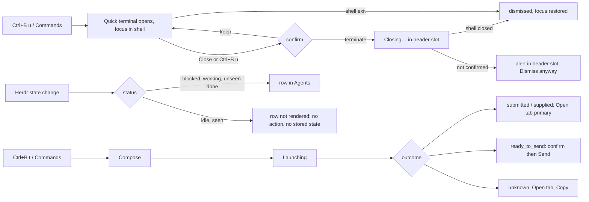

# Polish: Quick terminal, Ask an agent, Agents queue (idle auto-leaves)

Design only. No product code, tests or config were changed; nothing was built, linted or run. Source inspection plus one real native screenshot (`~/.local/state/cockpit/quick-terminal-evidence-9d89d363/native-final/visible-3.png`). Mock: `mocks/polish.html` (tokens copied from `src/app/styles/tokens.css`, geometry from the real stylesheets; the "before" panels are reconstructed). Existing behavioural spec for Ask stays authoritative for truthfulness and recovery: `planning/quick-agent-question-2026-10-26/ux-design.md` (not edited here).

## Goal & users

Keyboard-first operators opening a disposable shell (`Ctrl+B u`) or asking an agent (`Ctrl+B t`), and anyone scanning the Agents section. Outcomes:

1. Quick terminal looks like a Cockpit surface, states its scope, and never shifts while it reports status.
2. Ask dialog reuses the app's dialog chrome, keeps feedback to one reserved slot with short copy, and has no dead controls.
3. Agents queue is a pure projection of what needs the user. Idle agents drop out by themselves; there is nothing to dismiss and no dismissal state.

Non-goals: changing launch/delivery semantics, shortcuts, the confirm-on-close rule (DECISIONS.md:33), or Herdr behaviour.

## Evidence (existing patterns reused)

| Pattern | Source |
| --- | --- |
| Dialog chrome `task-setup`, `task-setup-header/-close (UiIcon "close")/-body/-row/-footer`, `.setup-primary` blue | `src/app/projects/taskSetup.css:1-30,124-145`; used by `SetupDialog.tsx:815`, `AddContextDialog.tsx:103`, `LibraryConfirmDialog.tsx:97` |
| Reserved fixed-height dialog status slot | `src/app/ErrorSlot.tsx:6-23`, `src/app/errorSlot.css:13-16` (44px, `placement="dialog"`) |
| No banners that shift content; errors in reserved slots | skill `cockpit-design-polish-mock-then-implement` |
| Pane header 28px with 2px accent top edge when selected | `src/app/styles/terminal.css:158-176`; tokens `--select-edge*` |
| Chip style | `.switcher-kind` `src/app/styles/overlays.css:497` |
| `withShortcut` / `formatShortcut` (hides the hint when Herdr shadows the prefix) | `src/app/input/shortcuts.ts:212-224` |
| Native `window.confirm` is the convention for closing Space/tab/pane | `src/app/shell/useWorkbenchActions.ts:77-96` |
| Quick terminal is a Cockpit-owned disposable shell in the source pane's directory; close confirms | `DECISIONS.md:33` |
| Idle/Done semantics: Done = finished, not yet seen; Idle = seen | herdr.dev/docs/concepts; `research/ui-agent-attention-queue.md:43` |
| `returnFocusFromSidebar()` for leaving the sidebar | `src/app/input/shortcuts.ts:322` |

Observed defects (source + screenshot):

- **Quick terminal.** `overlays.css:44-47`: 80%×80% of the work area (huge on wide screens), `padding:6px 10px` header with the title only, Close is an unstyled-looking grey button, no cwd/disposable/shortcut cue. The `closing` / `unconfirmed` rows (`QuickTerminal.tsx:82`) have no CSS and insert a row above the terminal.
- **Ask.** Private duplicates of shared chrome: `quickAsk.css:2-5` (header, text "×" close), `:35-43` (footer, hard-coded `--color-hex-*` primary). Footer status `min-height:24px` grows with 100–200 character messages (`QuickAskDialog.tsx:81-91`). Agent cards are 44px, two lines, sub-label repeats the name (`omp`, `pi`, `claude`). The delivery sentence only exists inside "More" (`:136`). Primary is a disabled "Started/Sent/Starting…" button after launch (`:147`), i.e. a dead control.
- **Agents queue.** `Agents.tsx` rendered hover `Dismiss`, Delete/Backspace, Queue/All, "N hidden · Show all", Hidden/Restore all. Working tree is being edited concurrently (my reads of `Agents.tsx`, `agentAttentionModel.ts`, `sidebar.css` changed mid-session): the WIP already drops those and filters `display === "idle" && !unseen`. This spec describes the target for that slice and Open question 1 flags what WIP still keeps.

## Flow

## Screens/components

Mock: `mocks/polish.html` sections 1–3.

### 1. Quick terminal

Geometry. Centered in `.workarea-content` rect (existing `ResizeObserver`), width `min(960px, rect.width − 48px)`, height `min(640px, 80% of rect.height)`, never below 320×200; clamp to rect minus 8px under 640px wide. Rationale: a quick shell needs ~120 columns, not 190+ on a wide window. (Option A, keep 80%×80%, in Options.)

Container: keep `1px solid var(--accent)` (same language as `.server-popup`), add `border-radius: var(--radius-panel)`, `overflow:hidden`, keep shadow and scrim.

Header, 32px, `background: var(--chrome-bg)`, bottom hairline, shared `inset 0 2px 0 var(--select-edge)` top edge:

| Slot | Content |
| --- | --- |
| title | "Quick terminal", `--font-size-xs`, 600 |
| chip | "disposable", `.switcher-kind` look; title "Closing terminates this shell" |
| cwd | source pane `cwd` in `--font-mono` 2xs muted, left-truncated (`direction:rtl` trick in mock), `title` = full path. Omit when the source pane has no `cwd`; never guess |
| status slot | `flex:1`, right aligned, 24px high, nowrap. Holds `Closing…` (`role="status"`, refresh icon) or `Closure not confirmed` (`role="alert"`, `--blocked`, info icon, `title` carries "The shell or detached processes may still be running.") |
| Close button | 24px, transparent, hover `--surface-hover`, label `Close` + `<kbd>` from `formatShortcut("quick-terminal")` (omitted when empty). `aria-label="Close quick terminal"` unchanged. States: pending → disabled "Close"; unconfirmed → label "Dismiss anyway", `--blocked` outline |

Body: unchanged `TerminalPane`; add 0 extra chrome. The old `
` rows between header and body are deleted (their text moves into the slot).

Close confirmation: unchanged native `window.confirm` (text and sequence as today). Option B (inline confirm in the slot) is drawn in the mock but not recommended.

### 2. Ask an agent

Chrome. Replace the private header/close/footer/primary with the shared ones: section `setup-dialog task-setup quick-ask`; `<header className="task-setup-header">` with `<h2>` + `<button className="task-setup-close"><UiIcon name="close"/></button>` (same `aria-label="Close"`); body `task-setup-body`; footer `task-setup-footer` containing `<ErrorSlot placement="dialog" …/>` then the buttons; primary keeps `setup-primary`. Delete `quickAsk.css` rules for `.quick-ask-header`, `-close`, `-body` padding, `-footer`, `-status`, `-actions`, `-primary`, `-link` (keep agent grid, textarea, hint, more).

Agent picker. Native radios kept, restyled to one-line 32px chips: name only, leading selected state = border + fill + trailing `✓`. Unavailable: dashed, muted, suffix `· not on PATH` on the same line (still visible text, not just a tooltip; `aria-label` keeps "Not found on PATH"). While `availability === null`: neutral chips (no "Checking…" text flicker); status announced only if the check fails. The executable name moves to `title`. Radios unchanged semantically (`role="radiogroup"`).

Question row. Placeholder shortened to "Ask anything…". Hint: `<kbd>Ctrl</kbd> <kbd>Enter</kbd> asks · <kbd>Enter</kbd> adds a line` (use platform: Cmd on macOS; `kbd` style exists at `overlays.css:175-179`). Byte counter unchanged. New one-line **delivery line** below the hint, always visible before commitment (ux-design.md "capability before commitment"):

| Condition (existing props) | Line | Dot |
| --- | --- | --- |
| `directLaunch` | "Sent at launch in the command line." | accent |
| `manualPaste` | "You paste it into the agent yourself." | warning |
| otherwise | "You confirm the agent’s prompt before it is sent." | warning |

The long explanations in "More" stay (and the argv privacy warning at `QuickAskDialog.tsx:130` stays; it is a validation-class message under the hint). "Switch to the new tab" stays in More.

Runs in. One line: mono path (`code`, ellipsis, `title`=full), muted source (`props.cwdSource` shortened: "Space checkout" / "Terminal folder"), `Change` link-button right aligned. Editing state unchanged (input + existing no-checkout message).

Footer status slot = `ErrorSlot placement="dialog"` (44px reserved, 2 lines, ellipsis + `title` for the rest). Proposed copy (each keeps the truth constraints of ux-design.md: never "answered/consumed", never "not sent" when outcome unknown):

| Phase | Current (≈chars) | Proposed |
| --- | --- | --- |
| creating_tab | "Creating a new tab. Your question has not been sent." / launch variant 80+ | "Creating tab… question not sent." / "Starting tab with your question. Can't be recalled." |
| checking_environment | 55 | "Checking tab… question not sent." |
| starting_agent | 60 | "Starting OMP… question not sent." / "Starting OMP with your question." |
| waiting_for_agent | 95 | "OMP needs input in “tab” before it takes the question." |
| ready_to_send | 140 | "OMP is ready. Check its prompt, then confirm." / manual: "Copy the question and paste it in the tab yourself." |
| sending | 62 | "Sending… can't be cancelled." |
| submitted | 110 | "Herdr acknowledged the send to “tab”. Check it for a reply." |
| initial_question_supplied | 140 | "Question supplied at launch in “tab”. Receipt not confirmed: check the tab." |
| cancelled | 30 | "Not sent." |
| failed | variable | "OMP didn't get your question: <message>. Tab “x” is still open." (clamped, full in `title`) |
| outcome_unknown | 95 | "Couldn't confirm the send. Check the tab before asking again." |
| no agent on PATH | 70 | unchanged |

Footer buttons per phase (max 3; primary = next useful action):

| Phase | Buttons (left→right) |
| --- | --- |
| editing | Cancel · **Ask OMP** |
| creating/checking/starting/sending | Don't send / Stop waiting · **Starting…/Sending…** (disabled progress label; the only disabled primary allowed) |
| waiting_for_agent | Open tab · Don't send |
| ready_to_send | Open tab · Don't send · **Send question** (disabled until confirm; manual paste: Copy question · Open tab · Close, no Send) |
| submitted / initial_question_supplied | New question · Close · **Open tab** (replaces disabled "Sent"/"Started") |
| outcome_unknown | Copy question · Dismiss (disabled until acknowledged) · **Open tab** |
| failed | returns to editing with the failure in the slot |

Confirmation checkbox: bordered row in the body, directly after the retained question (`.chk` in mock), label unchanged ("I confirmed the agent's normal question prompt is visible and empty" or ux-design wording). Retained question: `readonly` textarea, muted, `resize:none`; submitted/supplied add hint "Kept here. New question clears it." (matches ux-design.md:82).

Narrow (≤480px): existing rules; status slot above buttons (`flex-basis:100%`, order −1), 2 agent columns, stacked label rows.

Tab strip chip (`TabStrip.tsx:98`, `.tab-strip-action`): unchanged.

### 3. Agents queue

Section: heading `agents` + count only (no Queue/All switch, no `agent-view-switch`). Rows unchanged (26px, 18px glyph, `space · tab`, urgent flag word, selected fill + 2px left edge). Hover = background only. No `agent-row-action`, no Delete/Backspace, no hidden heading/footer, no Restore.

Visible rule (display-level, per row): show when `display` is `blocked`, `working`, `unknown`, or `done` with an unseen completion. Hide when `idle` and not unseen. (Unknown stays visible: fail visible, per `research/ui-agent-attention-queue.md` principle 6 and current tier 4.)

Empty: single muted line `No agents need attention` (replaces "No agents detected"; idle agents exist but are not listed). No extra explanatory copy.

Row leaving. Rows are removed on the next snapshot, no animation (consistent with the "no glow/effects" decisions; zero state to manage). Count and section height follow (`Sidebar.tsx:32` uses the same derivation). Where did my agent go: the Space row and Ctrl+K switcher still list every agent (`quickSwitch.ts` is independent of the queue).

Kept (current WIP, explicit actions on unseen results only): Shift+Enter marks seen, activation marks seen after Herdr confirms focus, "Past results not seen" entries with Mark seen. `Attention unavailable. Retry` and the recovery-incomplete notice are unchanged (pre-existing in-flow notices; out of scope).

## Interaction & keyboard

- Quick terminal: `Ctrl+B u` opens/closes (unchanged, `QuickTerminal.tsx:58-77`); Tab cycles header button ↔ xterm (unchanged); focus returns to opener. Header button label shows the shortcut only when `formatShortcut` returns text.
- Ask: Ctrl/Cmd+Enter starts only in Editing (unchanged); Tab trap and Esc per phase unchanged. Primary/secondary reorder must keep DOM order: Close → agents → Question → delivery line → Runs in → More → checkbox → footer buttons.
- Agents: Arrow/Home/End move DOM focus only; Enter/Space/click activate; Shift+Enter marks seen. Removed: Delete/Backspace.
- **Focus when the focused row disappears** (new requirement from automatic removal): the removed `handoff` logic only covered dismissals. In `Agents.tsx` record the focused row key+index on list focus; in a layout effect, if the previously focused key is gone and `document.activeElement` is `body`, focus the row now at that index (clamped), else call `returnFocusFromSidebar()`. Never move focus if it was elsewhere. Do not announce removals (routine). Existing polite announcement for newly blocked/unseen stays.

## Accessibility

- Quick terminal: dialog label "Quick terminal" unchanged; slot is `role="status"` (Closing…) or `role="alert"` (not confirmed), only one live region; header button focus ring `2px var(--focus-strong)` inset; chip text not colour-only; kbd inside the button is part of its visible label, `aria-label` stays "Close quick terminal".
- Ask: unavailable agent reason is visible text and in the accessible name; delivery line is `aria-describedby` of the Question textarea; slot uses `ErrorSlot` roles (`status`/`alert`); disabled Send reason stays readable (checkbox + helper); 36px+ chip hit area is satisfied by the 32px chip row plus 6px gap (existing minimum 28px) `[INFERENCE]` — implementation should measure.
- Agents: state is glyph shape + word, never colour alone (unchanged); empty line is plain text; no hover-only control remains, so coarse-pointer rules for `.agent-row-action` can be deleted.
- Contrast: all colours are existing tokens; actual ratios are not verified here.

## Options considered

| Choice | Options | Recommendation / tradeoff |
| --- | --- | --- |
| Quick terminal size | A 80%×80% (today). B `min(960,…)×min(640,…)` centered | **B**. A is oversized on wide monitors and fills the window it is meant to sit over; B costs updating the geometry assertions in `QuickTerminal.test.tsx:84-87` |
| Close confirmation | A native `window.confirm` (today). B inline in header slot | **A this pass**: same as closing Space/tab/pane and DECISIONS.md:33 only demands a confirmation. B looks better but introduces a second convention and rewrites four tests |
| Status placement (terminal) | Row under header (today). Header slot | **Header slot**: no layout shift |
| Ask chrome | Keep private CSS. Adopt `task-setup-*` + `ErrorSlot` | **Adopt**: deletes ~12 CSS rules and the hard-coded hex duplicates |
| Agent picker | 44px two-line cards (today). 32px one-line chips | **Chips**: executable name is redundant; reason for unavailability stays visible on the same line |
| Post-launch primary | disabled "Started/Sent" (today). Open tab as primary | **Open tab**: no dead control |
| Idle in queue | Dismiss button (today). Auto-hide idle, nothing to dismiss | **Auto-hide** (user requirement); the dismissal stamp is the only thing that hid idle rows, so removal is not cosmetic |
| Focused/selected idle agent | A leaves with the rest. B pin the Herdr-focused agent while idle | **A**: B keeps a derived-but-sticky exception and defeats "automatic". Locator after leaving = selected Space row + Ctrl+K |
| Queue/All switch | Keep read-only All. Remove | **Remove** (WIP already did): All existed only for hidden rows; idle agents remain reachable in Spaces and Ctrl+K |

## Open questions (options + recommended default)

1. **Seen state.** Main's interpretation: keep Cockpit-held *seen/acked* for unseen completions (and historical "Past results not seen"), remove only dismissal. User wording was "no state management in cockpit". Option 1 (default, matches WIP): keep seen store, completions survive Herdr's done→idle flip. Option 2: fully derived queue = Herdr `blocked|working|done|unknown`; delete `agent_attention.rs`, the two routes/native commands, protocol DTOs, client ops, `useAgentAttention`, historical entries and Shift+Enter. Cost of 2: a completion seen in any Herdr client, or coalesced between snapshots, disappears (research M1/M2). **Recommend 1 unless the user confirms Option 2**; the mock fits both (rows identical).
2. Queue row for an agent that just finished (working→idle with inferred completion) shows Done until seen. Under Option 2 it would show Idle and vanish. Default: follow Open question 1.
3. Exact "disposable" chip wording vs icon-only. Default: wording.
4. Delivery-line copy is new product text. Default as in table; Main may edit.
5. Clamp numbers (960×640) are design defaults, not measured. Default as written.

## Acceptance scenarios (observable checks for Main)

Future checks, not exercised here.

1. `Ctrl+B u` in a 1600×900 window: terminal ≈960×640 centered over the work area; header shows title, `disposable`, source cwd, `Close Ctrl+B u`; top 2px accent edge; shell prompt focused.
2. Shrink to <640px: cwd chip, then chip, then kbd hide; terminal still ≥320×200; no horizontal scroll.
3. Close → native confirm; cancel keeps the shell; accept shows `Closing…` in the header slot with no body movement; shell exit closes without confirm; failed termination shows `Closure not confirmed` (alert) and `Dismiss anyway`; focus returns to the opener.
4. Source pane without cwd: no cwd chip, no empty gap.
5. Ask opens focused on Question; header close is the icon from other dialogs; footer height is identical in every phase (record `.error-slot-dialog` height 44px before/after a long failure); long message is clipped with full text in `title`.
6. Agent chips are 32px high, names only; an unavailable agent shows `· not on PATH` and is not selectable; no "Checking…" flash.
7. Delivery line is visible before Ask for direct-launch, manual-paste and confirm-before-send agents.
8. After launch (submitted/supplied) the primary is **Open tab** and enabled; no disabled "Started/Sent" button anywhere.
9. Agents: an idle agent never appears; a blocked/working/unseen-done agent does; no `Dismiss`, `Restore`, `Show all`, `Queue/All` text or Delete-key effect exists; empty state reads "No agents need attention".
10. Keyboard focus on an Agents row that turns idle (activate it elsewhere, or have Herdr flip it): focus moves to the neighbouring row or leaves the sidebar, never to `body`.
11. Screen reader: new blocked/unseen row still announced politely; row removal is silent.
12. Native WebKit run: quick terminal renders text (known first-screenshot blank noted in `docs/verification-log.md:394`; take a later frame) and `Ctrl+B Ctrl+B` still sends byte `02`.

## Implementation guidance (target files)

Slice Q — Quick terminal (one agent):
- `src/app/shell/QuickTerminal.tsx` — header/status slot markup, new `cwd` prop, geometry from rect (`left/top/width/height` computed with the clamp), shortcut hint via `formatShortcut("quick-terminal")`; delete the two status `
`s.
- `src/app/styles/overlays.css:44-47` — replace `.quick-terminal*` rules (add `.quick-terminal-title/-chip/-cwd/-status/-close`).
- `src/app/shell/Workbench.tsx:29-36,103` — look up the source pane's `cwd` from `runtime.snapshot.panes` by `runtime.sourcePaneId`, pass as `cwd` (omit if absent).
- `src/app/shell/QuickTerminal.test.tsx:84-87` — geometry expectations; add cwd/shortcut/slot assertions. Keep the `window.confirm` tests.
- `docs/keyboard-shortcuts.md:15,56` only if wording changes (it need not).

Slice A — Ask (one agent):
- `src/app/quickAsk/QuickAskDialog.tsx` — chrome swap, `ErrorSlot`, chip picker, delivery line, Runs-in line, footer phase table, short copy.
- `src/app/quickAsk/quickAsk.css` — delete superseded rules, add chip/deliv/runs/chk rules; narrow media rules keep.
- `src/app/quickAsk/QuickAskDialog.test.tsx` — it pins `.quick-ask-more input[type="checkbox"]` and the "Ask OMP" label (lines 59-61): keep those hooks or update; add assertions for no disabled primary and slot height class.
- Reused, unchanged: `src/app/ErrorSlot.tsx`, `src/app/errorSlot.css`, `src/app/projects/taskSetup.css`.

Slice I — Agents queue (coordinate with the worker already editing it; do not fork):
- `src/app/sidebar/Agents.tsx` — remove any remaining switch/footer/dismiss remnants, empty copy, focus-recovery effect, no hover control.
- `src/app/sidebar/agentAttentionModel.ts` — row type has no `canDismiss`/`hidden`; visible filter as specified (WIP has it).
- `src/app/sidebar.css` — delete `.agent-row-action`, `.agent-view-switch`, `.agent-hidden-*`, coarse-pointer rule for the action; keep `.agent-historical`/`.agent-notice` while Open question 1 = Option 1.
- `src/app/sidebar/Agents.test.tsx`, `agentAttentionModel.test.ts`, `src/app/session/agentAttention.test.tsx` — remove dismiss/restore cases, add focus-recovery and empty-copy cases.
- Backend/contract removal, docs: `crates/cockpit-core/src/agent_attention.rs`, `crates/cockpit-protocol/src/v1.rs:233-289` + `typescript/v1.rs`, regenerate `src/protocol/generated/*`; docs `DECISIONS.md:27,453,455`, `CONTEXT.md:57,72-76`, `docs/keyboard-shortcuts.md:9-11`, `research/ui-agent-attention-queue.md` (mark superseded). Per-file list is in the InboxResearch report; do not duplicate here.

## Proof approach (Main runs once, after slices land)

- Static: `npx tsc --noEmit`; `bunx vitest run src/app/shell/QuickTerminal.test.tsx src/app/quickAsk src/app/sidebar src/app/session/agentAttention.test.tsx src/app/App.integration.test.tsx`; `cargo test -p cockpit-core agent_attention` and protocol `export-typescript --check` only if the Rust/protocol slice runs.
- Visual: `bun run build`, then a disposable fixture (`python3 scripts/verify/ui_polish_runtime.py start <root>`; never the live session) and browser screenshots at 1600×900, 900×700 and 360×700 of: quick terminal (open, closing, forced unconfirmed), Ask (compose, launching, ready_to_send, submitted, unknown, narrow), sidebar with one blocked, one working, one done and one idle agent, then activating the done row. Compare against `mocks/polish.html`.
- Native: one WebKit run on a private compositor for quick terminal rendering, focus return and `Ctrl+B Ctrl+B`, per skill `cockpit-native-smoke-and-limited-worker-fallback`. Stop fixture, remove root, close browser afterwards.
- Report what was not exercised (Option B confirm, contrast ratios, macOS Cmd hint).

## Examples

- `planning/terminal-ask-inbox-polish-2026-10-27/mocks/polish.html`: standalone; before/after for quick terminal (open, closing, unconfirmed, option B, narrow), Ask (compose before/after, launching, ready_to_send, submitted, unknown, narrow), Agents queue (before/after, row lifecycle, selected row, historical entries).
