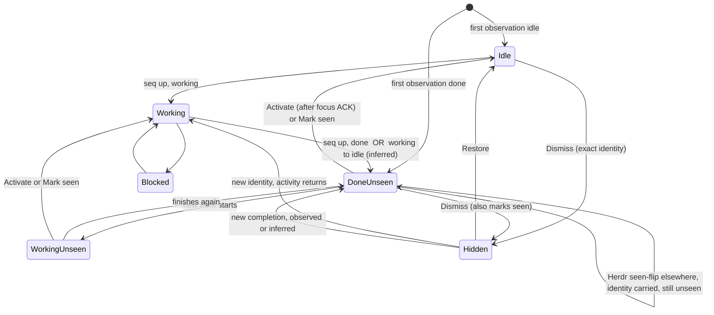
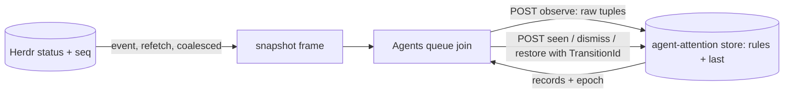

# Agent attention queue: UX and transition-identity design

Status: design proposal, not implemented. Author: AttentionDesign. Examples: [`ui-agent-attention-queue/`](ui-agent-attention-queue/).

This document changes the Agents list from a pure projection of Herdr's current agent statuses into an email-like attention queue with durable acknowledgment. It deliberately replaces two current statements: `research/ui-design-direction.md:288` ("No ... Cockpit-managed acknowledgement state") and `archive/decisions-log.md:78` ("Cockpit does not persist local acknowledgement state"). The replacement must be recorded in `DECISIONS.md` (proposed text in section 3.8) before implementation.

## 1. Goal & users

**User.** One operator supervising several Herdr agents (OMP, shells running agents, workers) from the Cockpit sidebar, often with the window unfocused, the sidebar collapsed, or Cockpit restarted in between.

**Questions the queue must answer** (`research/ui-design-direction.md:13-15`): which agent needs me next, and did I miss anything while I wasn't looking.

**Behaviors requested**

1. Email-like queue: an item stays until the user deals with it.
2. Durable acknowledgment: survives window reload, app restart, a second Cockpit client and Herdr restart.
3. Idle agents leave the queue after the user dismisses them.
4. New activity on a dismissed agent makes it reappear.
5. Done is retained until explicit activation or explicit acknowledgment. Merely being focused by anything else does not clear it.
6. "All agents" recovery: the user can always see, restore and reset everything the queue hides, and a failing store never hides agents.
7. Keyboard accessibility with parity for every pointer action.

**Non-goals.** No inbox popup or separate surface (`ui-design-direction.md:287-288`; the queue stays the Agents section). No chat transcript, avatars or counters dashboard. No change to Herdr state, focus, or the orchestration `attention` projection (`crates/cockpit-core/src/orchestration/projection.rs:225`), which concerns supervised runs, not sidebar agents. No notifications outside the window.

## 2. Evidence (existing patterns reused, existing failure modes)

### 2.1 What exists today

| Fact | Evidence | Consequence for the design |
| --- | --- | --- |
| The Agents list is a pure function of the latest `snapshot.agents`; it keeps no memory. | `src/app/sidebar/Agents.tsx:23-27`, `src/app/shell/WorkbenchContent.tsx:76`; `grep` of `src/app` finds no agent persistence (`localStorage` is used only for sidebar width/collapse, Spaces view, Notes, viewer layout). | Everything durable is new. |
| Order: blocked, done, working, idle, unknown; within a state newest `state_change_seq` first, then focused, then snapshot index. | `src/app/sidebar/spaceTree.ts:27-45`; `DECISIONS.md:27`. | Keep the tier idea; add one deliberate departure (section 3.4). |
| Row = one `<button>`, key `${pane_id}:${name}`, roving single tab stop, `aria-current` on Herdr-confirmed selection, `aria-busy` while a focus request is pending. Selected row reveals `State · agent`; unselected Blocked/Done rows print the state word. Hover, DOM focus and pending never grow rows. | `Agents.tsx:24-26,39-55`; `src/app/sidebar.css:277-293,658-700`; `DECISIONS.md:443,449`. | Row geometry (26 px, 18 px badge) is a fixed contract. New cues must fit it. |
| Arrow/Home/End move DOM focus only; Enter/Space/click request Herdr focus; selection follows Herdr's acknowledgment. | `src/app/sidebar/useRovingList.ts:1-66`; `DECISIONS.md:449`. | "Explicit activation" is a click/Enter on a row; acknowledgment attaches to the confirmed focus. |
| Spaces rows already support `ContextMenu`/`Shift+F10` row menus, right-click menus, and focus recovery when a focused row is removed. | `src/app/sidebar/Spaces.tsx:146-176,188-195`; `src/app/shell/ContextMenu.tsx:3-6,54-62`. | Reuse for agent rows; add an `agent` context target. |
| A section-level two-way view switch with `aria-pressed`, persisted in `localStorage`, narrowing at `@container sidebar (max-width: 260px)`, and a coarse-pointer rule that makes hover-only controls always visible. | `Spaces.tsx:292-301`, `src/app/sidebar/spaceTagView.ts:7-14`, `sidebar.css:752-758,841-849`. | Queue / All switch reuses this exact pattern. |
| Row-local mutation notes live directly under the row. | `ui-design-direction.md:101,232`; `Spaces.tsx` `notes`. | Action errors for agent rows follow suit. |
| Hidden-sidebar attention cue: a dot on the sidebar toggle, named "(an agent is blocked)". | `src/app/shell/TabStrip.tsx:61-62`, `src/app/styles/tabs.css:181-182`, `WorkbenchContent.tsx:69`. | Extend, do not add a second cue. |
| Ctrl+B a focuses the Agents list; Ctrl+K "Go to Space or agent…" searches all agents; unused prefix key `u`. | `src/app/input/shortcuts.ts:129,131` (prefix keys used are listed at `shortcuts.ts:98-140`; `u` does not appear). | Quick switcher stays the always-complete route (all agents, hidden included). |
| Token set: `--done #94e2d5`, `--blocked #f38ba8`, `--working`, `--idle`, `--surface-hover/-selected`, `--focus-strong`, `--font-size-2xs`, `--radius-control`. Focus ring: 2 px `--focus-strong`, `outline-offset:-2px`. | `src/app/styles/tokens.css:5-28,46,66`; `sidebar.css:328-332`. | No new colors or tokens required. |
| Durable cross-client Cockpit-owned records already exist: `state_root/space-tags/space-tags.json` under a named file lock, atomic write, bounded size, SHA-256 socket-namespace + session + resource id key, prune confirmed-absent resources, HTTP + native + CLI over one service. | `crates/cockpit-core/src/space_tags.rs:13-16,57-110`; `crates/cockpit-host/src/transport/registry.rs:72-89`; `DECISIONS.md:447`; `crates/cockpit-core/src/ephemeral.rs:122-131`. | Same store pattern for acknowledgments. |
| Snapshots carry optional additive fields (`herdr_shell`); embedding an attention overlay there was considered and rejected (section 7). | `crates/cockpit-protocol/src/v1.rs:313-316`. | Records travel on a space-tags-style endpoint and are joined client-side. |
| Herdr semantics: `done` = "finished and you have not looked at it yet"; `idle` = finished/waiting and seen. Each Herdr client tracks which completions it has displayed; CLI/API status uses the **server's** seen state, which explicit pane/agent focus sets and reading output does not. | <https://herdr.dev/docs/concepts/>. | A Cockpit-side "seen" is exactly Herdr's per-client viewed-completions idea, made durable. |

### 2.2 How observations get missed or reordered today

| ID | Failure | Evidence |
| --- | --- | --- |
| M1 | **Coalesced observations.** The host emits one whole snapshot per `Changed` event after refetching Herdr; transitions that happen between fetches (working→done→idle) are never seen. | `crates/cockpit-host/src/transport/session_stream.rs:182-189` (`Changed` → `fetch(Live)`), `:115-119`. |
| M2 | **Seen-flip.** Herdr flips `done`→`idle` on the server when the pane is focused by anything: Cockpit Space/tab/pane/agent focus, another Herdr client, CLI. Cockpit's own focus paths all send Herdr focus. The Done row vanishes without the user ever having looked at the agent (for example when Cockpit changes Space and the pane lands in a hidden or unattached terminal). | `src/app/shell/useWorkbenchActions.ts:32-61`; external focus is a recognized class, `src/app/layout/reconcile.ts:25-29`; Herdr docs above. `[INFERENCE]` that the flip happens on every one of these paths; verify in the disposable fixture (scenario A1). |
| M3 | **Nobody was watching.** Window closed, reloaded, backgrounded or disconnected: React state is the only memory, and a reload starts with no baseline to diff. | `sessionStore.ts:104-135` (`switch` resets to `initialSessionState`). |
| M4 | **Restart reuse.** `state_change_seq` is Herdr-server scoped and defaults to 0 when absent; a Herdr restart can reset it and reuse pane ids, so a stored `seq` is only meaningful together with the server instance. `[INFERENCE]` for the reset; the default-0 and id-reuse facts are in the repo. | `crates/cockpit-herdr/src/cli.rs:323-327`; `DECISIONS.md:447` (Space id reuse after restart); `SessionSnapshotResponse.server_instance`. |
| R1 | **Out-of-order sources.** Stream frames are ordered by `(generation, sequence)`, but a mutation response snapshot enters through `snapshot/authoritative`, which replaces `snapshot` without comparing anything; only the caller's `responseIsCurrent` guard fences it. | `src/client/streamOrder.ts:40-155`; `src/app/session/sessionStore.ts:117-119`; `src/app/session/mutationCoordinator.ts:106-107`. |
| R2 | **Tie-break by snapshot index** when `state_change_seq` is missing or equal. | `spaceTree.ts:40-43`; `cli.rs:323-327`. |
| R3 | **Write/observation race.** A dismiss or acknowledge sent for what the user saw can land after the agent changed again. No such write exists today; the design must fence it. | new |
| R4 | **Two clients** (browser build and native window, or two windows) writing acknowledgments. | `docs/keyboard-shortcuts.md` documents both builds; tags store precedent. |
| R5 | **Rows move under the pointer.** The list re-sorts on every transition; a click can land on a different agent than the one aimed at. Click targets are keyed by pane id, but the hit target moves. | `Agents.tsx:23`; design direction forbids slide animation (`ui-design-direction.md:299`) but not re-sort. |

## 3. Flow

### 3.1 Vocabulary (UI words)

Keep the product's terms (`ui-design-direction.md:30,316`): **Agents**, **blocked / done / working / idle / unknown**. New UI words, chosen to match Herdr's own "seen" vocabulary:

- **Seen / not seen**: whether Cockpit has recorded that you looked at a completion. A "not seen" completion is shown with the word **Done**.
- **Dismiss**: hide an idle agent from the queue until it has new activity.
- **Hidden**: dismissed and still unchanged. **Restore** puts it back.
- **Queue / All**: the two views of the Agents section.

Never "inbox", "archive" or "read" in UI copy (`DECISIONS.md` and design direction already ban an inbox surface; "archive" suggests deletion).

### 3.2 Identity model

All identities are scoped by the session namespace the Space-tags store already uses: `SHA-256(canonical socket path)` + `session_id` (`space_tags.rs:81-90`).

```text
AgentKey      = (pane_id, agent_name)                      one record per pane; match key across epochs
Incarnation   = terminal_id                                from the pane list (AgentSummary has none, v1.rs:269-298); compared only within one epoch
Epoch         = ordinal assigned by the store to each distinct server_instance it has proven live in this namespace, strictly increasing
TransitionId  = (epoch, state_change_seq)                  compared lexicographically; never compare seq across epochs
```

`server_instance` alone is not durable identity (`DECISIONS.md:447`), which is why the store converts it to a monotonically increasing ordinal: after a Herdr restart `(epoch 2, seq 3)` is correctly greater than `(epoch 1, seq 900)`.

Why `terminal_id` is not a cross-epoch key: its stability across a Herdr restart is unverified (open question 2), and keying on it would drop unseen completions at restart. Within one epoch a different `terminal_id` for the same pane, or a different agent name in the pane, is a new incarnation: the old record is replaced and the row appears as a new agent (fail visible). Pane ids are reused after restart (`DECISIONS.md:447` for Space ids, `[INFERENCE]` for panes), so across epochs `(pane_id, agent)` can match a different process; that can only keep a completion visible or an idle row hidden after a restart, and the carry rule below limits the latter to agents that look idle and unchanged.

An acknowledgment, a dismissal and a detected completion each name an exact `TransitionId`. They never name "the agent". This is the rule that makes late, duplicate, reordered and cross-client writes harmless:

- Acknowledgments are monotonic: `acked := max(acked, target)`.
- A dismissal is valid only for the exact `TransitionId` the user saw and only while the agent is still at that identity.
- Anything with a different identity is new activity.

Stored record per agent key:

| Field | Meaning |
| --- | --- |
| `last` | `{id: TransitionId, status, observed_at}` newest observation applied. Observations older than `last.id` are ignored (reordered). |
| `completion` | `{id, at, inferred}` newest completion Cockpit has recorded: a literal `done`, or an inferred finish. Kept after acknowledgment so the user can mark it not seen again and so undo works. |
| `acked` | `TransitionId` or null: highest completion identity the user has seen. |
| `dismissed` | `TransitionId` or null: the exact idle identity the user hid. |

Derived (never stored): `unseen = completion != null && !(acked != null && acked >= completion.id)`.

### 3.3 Observation algorithm

Clients submit raw observations; the **store** (core service, same layer as `SpaceTagService`) applies these rules under its lock. Clients never decide what a completion is, so two clients, a reload and a retried request all converge (R4, M3). Submissions are idempotent: an observation whose identity equals `last.id` changes nothing.

```text
observe(server_instance, observations O):          # O = [{pane_id, terminal_id, agent, status, seq}] from one live snapshot
  e = epoch_ordinal(server_instance)                # assigns the next ordinal for an unseen instance
  for a in O:
    key = a.pane_id; id = (e, a.seq)
    r = store[key]
    if r != null and (r.agent != a.agent or (r.last.id.epoch == e and r.terminal_id != a.terminal_id)):
        r = null                                    # new incarnation in this pane: replace, fail visible
    r = r or new record(pane_id, agent, terminal_id) with last = null
    if r.last != null and id < r.last.id:           # reordered or stale observation
        continue
    found = null
    if r.last == null:
        if a.status == done: found = {id, inferred: false}
    elif r.last.id.epoch < e:                       # Herdr restarted: seq values are not comparable
        if a.status == done: found = {id, inferred: false}
        if r.dismissed == r.last.id and not unseen(r) and a.status in (idle, unknown):
            r.dismissed = id                        # a restart is not activity; keep an idle agent hidden
    elif id > r.last.id:                            # something changed since the last observation
        if r.last.status == done and a.status == idle:
            carry(r, r.last.id -> id)               # seen-flip: acked, dismissed and completion identities follow; never a new completion
        elif a.status == done:                                  found = {id, inferred: false}
        elif r.last.status in (working, blocked) and a.status == idle: found = {id, inferred: true}   # finished (or answered then finished) while unobserved, or seen elsewhere
        elif r.last.status == idle and a.status == idle:        found = {id, inferred: true}   # activity missed between observations
    if found and not (r.acked != null and r.acked >= found.id): r.completion = {found, at: now}
    r.last = {id, status: a.status, observed_at: now}
  prune records whose pane is absent from a live snapshot (candidate revisions captured first, space_tags.rs:92-99)
  return records and e
```

Notes:

- A `working → idle` step with a larger seq becomes an **inferred completion**, so a completion that was coalesced away (M1) or seen-flipped by another client (M2) still lands as "Done, not seen". Cost of a false positive: one click. Cost of a false negative is the bug being fixed. Fail visible.
- `idle → idle` with a larger seq means "something happened between observations". It reveals a dismissed row (identity mismatch) and records an inferred completion. If the fixture shows seq also moves for non-activity events (rename, move, resize), restrict or drop this rule; scenario A9 decides.
- A Herdr restart gives a new epoch. Unseen completions stay unseen (older `acked`/`dismissed` epochs compare lower than any new identity). A dismissal carries into the new epoch only when `(pane_id, agent)` matches, nothing was unseen and the first new-epoch observation is idle or unknown (`terminal_id` is refreshed, not compared). Anything else reappears: fail visible. A first observation in a new epoch never infers a completion. An epoch is registered only after the service has proven that `server_instance` live against Herdr; a POST naming an older registered instance is refused (`agent_attention_target_changed`), so a late client cannot mint a higher epoch for a dead instance.
- The seen-flip carry covers both open Herdr behaviors (`[INFERENCE]`: whether `done → idle` on focus changes `state_change_seq`). If seq stays, the branch is a no-op; if it bumps, identities follow, which is required: otherwise the user's own Activate (acknowledge, then Herdr flips and bumps) would immediately re-create an unseen completion. Residual risk: a `done → working → done → idle` sequence coalesced into one observation is indistinguishable from a bare seen-flip and its second completion is carried as seen. Probe in scenario A9 and, if Herdr bumps seq on the flip, close the gap by consuming event payloads (option C in section 7).
- Missing `state_change_seq` (parsed as 0, `cli.rs:323-327`) is a valid identity: inference sees no change. Acceptable; the Herdr 0.9 schema lists `state_change_seq` as a built-in agent field (`herdr-0.9.0-protocol-22-schema-1.json:1390-1399`).
- When a live snapshot's agent has no record yet (first paint, in-flight POST), the client treats `status == done` as provisionally unseen so the first frame never hides a completion.

### 3.4 Display derivation and order

Per agent, from `(a.status, record)`:

| Herdr status | `unseen` | Dismissed at this identity | Display state (glyph + word) | Tier | In Queue |
| --- | --- | --- | --- | --- | --- |
| blocked | any | n/a | Blocked | 1 | yes, cannot be dismissed |
| done | yes | n/a | Done | 2 | yes |
| done | no (acked) | no | Idle | 4 | yes |
| done | no (acked) | yes | Idle | 4 | **hidden** |
| idle or unknown | yes (retained) | n/a | Done | 2 | yes |
| working | yes (earlier completion still unseen) | n/a | Working + `unseen` flag | 2 | yes |
| working | no | n/a | Working | 3 | yes |
| idle | no | no | Idle | 4 | yes |
| idle | no | yes (`dismissed == last.id`) | Idle | 4 | **hidden** |
| unknown | no | n/a | Unknown | 5 | yes |

Tier numbers are sort keys, lower first. A Herdr `done` that is acked sorts and reads as Idle.

Within a tier: newest `TransitionId` first, then focused, then pane id (replacing the snapshot-index tie-break so ties are stable across snapshots, R2).

**Deliberate departure from Herdr's TUI order** (record in `DECISIONS.md`): a working agent with an unseen earlier completion sorts in the Done tier, and a retained Done keeps its Done word and tier although Herdr already reports idle. Without this, a completion would sink beneath working rows exactly when the user is most likely to miss it. The glyph and word for Done follow the existing 18 px badge shapes; no new shape is added. A working-with-unseen row keeps the Working glyph and prints the flag `unseen` in the same flag slot Blocked/Done use.

**Effect on other surfaces**

- Space rows keep Herdr's rollup unless the next open question is resolved the other way: after "Mark seen" without focusing, Herdr still reports `done` for the Space, so the Space row would stay Done while the agent row says Idle (see open question 3).
- Quick switcher: all agents, hidden included; meta shows the display state and `· hidden`/`· not seen` (`src/app/shell/quickSwitch.ts:37-45`).
- Sidebar-toggle dot: shown when the highest tier is Blocked or Done (see 4.5).

### 3.5 Mutations

All mutations are explicit, carry the `TransitionId` of the row the user acted on, and are applied by the host under the store lock. The UI never changes the row optimistically: the row shows `aria-busy` until the response frame arrives (`DECISIONS.md:449`; `ui-design-direction.md:291`). Mutations are available only while Herdr sync is `live`; otherwise the controls say why (`aria-disabled` with the reason, as quick switch does).

| Action | Trigger | Effect | Refusal |
| --- | --- | --- | --- |
| Activate | click, Enter, Space, Ctrl+B u, quick switcher | Request Herdr focus of the pane exactly as today. When Herdr acknowledges that focus (selection becomes confirmed), send Seen for the identity of the row as it was when clicked. | Focus failure sends nothing: you did not see it. Clicking an already confirmed-selected row acknowledges immediately. |
| Mark seen | Shift+Enter, row menu | `acked := max(acked, completion.id)`. Row stays, now Idle. Does not touch Herdr, so Herdr may still report `done` for other clients. | If a newer completion exists than the target, only the target and older are seen; response flag `newer_unseen` and a row note. |
| Mark not seen | row menu (rows with a recorded completion), undo of Mark seen | `acked := null`. | Only if `completion != null`. |
| Dismiss | Delete/Backspace, hover or focus `dismiss` word button, row menu | `dismissed := target`; if the row is unseen it also marks seen. Valid for display state Idle or Done only. | `agent_attention_target_changed` if `last.id != target`: nothing is changed, the row note says why. Blocked, Working and Unknown rows have no Dismiss action (absent, not disabled). |
| Restore | Delete/Backspace on a hidden row, row menu, group "Restore all" | `dismissed := null` (one, or all in this session). | none |
| Forget all state | All view menu, confirm dialog | Delete every record in this session namespace. All agents reappear; Herdr `done` agents become unseen again. | none |
| Undo | Ctrl/Cmd+Z in the list, notice button | Sends the exact inverse of the last Dismiss/Seen batch (Restore, or Mark not seen), carrying the same identities. | If the inverse no longer applies (agent changed), the notice says so and nothing happens. |

Batch variants (heading menu): "Dismiss all idle (N)" and "Restore all hidden (N)". Batches are a list of per-agent targets, so each member is fenced individually; the result reports applied/refused counts.

### 3.6 Client rules

1. **Join, not embed.** The queue is `f(latest accepted snapshot, latest records response)` recomputed when either changes. Merges are monotonic (max by identity), so the arrival order of the two cannot make a row regress. The join key is `(pane_id, terminal_id from snapshot.panes, agent name)`.
2. **Epoch check.** Records carry the `epoch` the store assigned to the snapshot's `server_instance`. When the records' `server_instance` differs from the snapshot's, ignore the records for display (fail visible) until the next response.
3. **Provisional unseen.** Between a snapshot and the POST that records it, an agent with `status == done` and no record for that identity displays as unseen Done. Inferred completions appear when the POST returns (tens of milliseconds locally).
4. **Loading.** Until the first records response (or its failure) the Agents list shows the existing skeleton rows, not agents, so hidden rows never flash visible at startup. Failure → "store unavailable" (4.5). This mirrors the `ready`/`failed` flags of `src/app/session/spaceTags.ts:18-50`.
5. **Refresh triggers**, no timer: initial load, Herdr `server_instance` change, after every own write, window focus and `visibilitychange` (to pick up another client's writes), and each live snapshot whose agent tuples changed. Observation POSTs are coalesced to at most one per 250 ms and sent only when the tuple set differs from the last acknowledged submission.
6. **`snapshot/authoritative`** (mutation responses) merges per agent: keep the existing agent when its `state_change_seq` is higher than the incoming one for the same `server_instance` (R1, `sessionStore.ts:117-119`). The store separately ignores observations older than `last.id`.
7. **Pointer fence (R5).** On `pointerdown` on a row remember its row key; on `click` ignore the click when the target row key differs. The row order may change at any time without animation (`ui-design-direction.md:299`); keyboard focus follows the element by row key, not by index.
8. **Stale or disconnected.** Last-known rows stay readable, mutations are blocked, nothing is submitted (`ui-design-direction.md:220-226`). On recovery the next live snapshot is diffed against the stored `last`, which is how unobserved periods become inferred completions.

### 3.7 Persistence and contract surfaces

- **Store**: `state_root/agent-attention/agent-attention.json`, schema 1, bounded size, atomic write, named lock, same limits philosophy as `space_tags.rs:13-16` (limits never evict; at the cap the service reports `unavailable` instead of dropping records). Add it to the reset-preserved list in `crates/cockpit-core/src/ephemeral.rs:122-131`.
- **Why host, not `localStorage`**: the app ships as a browser build and a native build; each has its own `localStorage`, so acknowledgments would diverge, and a clear-site-data would silently resurrect every completion. `localStorage` stays for the Queue/All view choice only (like `cockpit.sidebar.spacesView.v1`): `cockpit.sidebar.agentsView.v1`.
- **Wire authority:** [`PLAN.md`, Shared interface contracts](../planning/agent-attention-queue-2026-10-26/PLAN.md) owns exact DTOs and store layout; [`examples/protocol.rs`](../planning/agent-attention-queue-2026-10-26/examples/protocol.rs) provides the typed contract. The identity and display rules in sections 3.2–3.4 remain UX requirements, not a second protocol convention.
- **Endpoints:** `GET` and `POST /api/v1/sessions/{session_id}/agent-attention`, plus native equivalents, following the Space-tags registration pattern (`registry.rs:72-89`).
- **POST:** `{ server_instance, observations: [raw tuples, at most 256], change: Seen | Dismiss | Restore { pane_id, agent } | RestoreAll | null }`. Observations are applied before one user change; the user change is fenced against the resulting stored `last`. No `changes` batch or per-change results array.
- **Response:** `{ session_id, server_instance, epoch, records, refused: { code, message } | null }`. A refused user change does not roll back observations.
- **Epoch proof:** GET proves the current instance and observes/prunes. A POST naming an unknown instance performs Herdr proof once before registering it; POSTs naming an older registered instance are refused. Ordinary POSTs use the store and do not fetch Herdr.
- **Failure:** no wire `status` field. Store/transport failures use ordinary error responses (`agent_attention_corrupt`, `_read`, `_lock`, `_limit`, `_outcome_unknown`; 503). Target change is 409; invalid input is 400. The client maps failures to its local unavailable state: show **every** agent with Herdr's current state only, an inline explanation and Retry. Never hide on failure.
- **Slice 2 actions:** `Mark not seen`, undo, Forget all and batch dismissal describe proposed UX, not first-cut wire actions. See the plan's open questions before implementing those actions.
- **Recording scope**: observations are submitted by whichever Cockpit clients are open, so nothing is recorded while no client is open. That gap is what `last` exists for: the first observation after downtime is diffed against it (M3, A11). No background daemon is required.

### 3.8 Records to update when implemented

- `DECISIONS.md` (new entry near `:27`/`:443`): "The Agents queue keeps Cockpit-owned seen/dismissed state keyed by (agent key, epoch, state_change_seq), stored host-side. Done stays until explicit activation or Mark seen even after Herdr reports idle. Dismissal hides only the exact idle identity. Failure or an unknown identity shows every agent. [Owner](src/app/sidebar/Agents.tsx). Rationale: Herdr's server seen state flips on any focus; the queue must not lose completions or hide agents on ambiguity."
- Replace `research/ui-design-direction.md:288` and the `:114` ordering sentence.
- Add `next-attention` to `src/app/input/shortcuts.ts` so `docs/keyboard-shortcuts.md` regenerates; document row keys in the Agents note.

### 3.9 Diagrams

Per-row display state (one agent key):



Activation (the explicit-acknowledgment path):

```mermaid
sequenceDiagram
  participant U as User
  participant UI as Agents row
  participant H as Herdr (focus)
  participant C as Cockpit host (agent-attention store)
  U->>UI: click / Enter on "Done" row (identity I)
  UI->>H: focus pane (row shows aria-busy)
  H-->>UI: focus confirmed in next frame
  UI->>C: POST seen(pane, terminal, agent, transition = I)
  C-->>UI: records with acked >= I (client rejoins with its snapshot)
  Note over UI: row becomes Idle; a newer completion J > I would stay unseen
```

Observation (what happens between Herdr and the queue):



### 3.10 Delivery order (nothing here is dropped, only sequenced)

**Slice 1 (the behavior requested):** store service and endpoint with the 3.3 rules (including inferred completions and the seen-flip carry), the client join and skeleton, Done retained after Herdr says idle, Queue/All switch, hidden footer and group, `dismiss`/`restore` word button and Delete dismiss/restore, Enter activate then Seen after focus acknowledgment, Shift+Enter Mark seen, Restore all, store-unavailable notice, pointer fence, deterministic tier order, **row accessible names and the polite live announcement for new Done/Blocked** (these are the request's keyboard/accessibility requirement, not extras).

**Slice 2:** row context menu with `agent` target, Mark not seen, Ctrl/Cmd+Z undo notice, Forget all, Dismiss all idle, `Ctrl+B u`, sidebar-toggle dot and name, quick-switcher meta, Space rollup decision (open question 3).


## 4. Screens/components

Layout is the existing Agents section. Nothing is added outside the sidebar except the toggle-dot refinement.

### 4.1 Section layout

```text
AGENTS SECTION (sidebar width 224-420 px)
┌──────────────────────────────────────────┐
│ agents  5          [Queue][All]      [⋯] │  28 px heading: h2, count of visible, view switch, menu button
│ ┌──────────────────────────────────────┐ │
│ │ Dismissed api · docs.         [Undo] │ │  list notice (only after a dismissal; role=status)
│ └──────────────────────────────────────┘ │
│ ✕ api-review · pane 1             blocked │  tier 1
│ ✓ side-project · tests              done │  tier 2 (Herdr done, or retained after Herdr says idle)
│ ◐ api-review · pane 2             unseen │  tier 2: working with an earlier completion not seen
│ ◐ docs · agent                            │  tier 3
│ ○ scratch · shell                dismiss │  tier 4 (`dismiss` word on hover/focus-within)
│ ──────────────────────────────────────── │
│   2 hidden · Show all                    │  footer row, only when hidden > 0
└──────────────────────────────────────────┘
ALL VIEW appends, below the unchanged queue rows:
│ Hidden · 2                  [Restore all]│  sticky 22 px group heading
│ ○ old-experiment · shell             hidden │  muted text, same 26 px row
```

Glyphs are the existing `StateGlyph` shapes (`src/app/sidebar/StateGlyph.tsx`): blocked `!` disc, done check disc, working half-ring, idle ring, unknown hollow ring. See [`states.html`](ui-agent-attention-queue/states.html).

### 4.2 Row

Unchanged: 26 px base, 18 px badge, `space · tab` with the tab pinned after the ellipsized Space, `.agent-flag` for the urgent word at the right, `State · agent` second line only for the Herdr-confirmed selected row.

Additions:

- Flag word: `blocked`, `done` (as today), `unseen` (working with earlier unseen completion), `hidden` (All view only, muted). Only one flag per row.
- Hover/focus affordance: a small text button **`dismiss`** (`restore` on hidden rows), lowercase mono `--font-size-2xs` like the flag words, 22 px high, with a 1 px `--border-strong` outline and the row's hover fill as background. It is absolutely positioned at the right edge of the row, like `.space-tag-add` (`sidebar.css:767-773`), so it covers the flag word and the end of the location text while shown and **never changes row size or the layout of the name**. Shown on `:hover`, `:focus-within` and always under `@media (pointer: coarse)` (`sidebar.css:845-849`). Only on rows whose display state is Idle, Done or hidden. It is a sibling of the row button, not nested in it, `tabindex="-1"` (keyboard route is Delete) with `aria-label="Dismiss <row description>"`. A close glyph is deliberately not used: `ui-design-direction.md:292` bans close-style affordances that imply a process was killed, and dismissal only hides a row; a word states what it does.
- Unseen freshness: for rows with `unseen` the `title` and the selected detail line include the time since Cockpit recorded the completion: `Done · omp · 12 min`. Timestamps come from the store's `at`, not from Herdr, and update at most every 30 s without a live-region announcement.
- Retained Done whose Herdr status is already idle: same glyph and word as live Done. The title reads `Finished 12 min ago. Marked not seen. Herdr now reports idle.` Inferred completions read `Finished while Cockpit was not watching. Marked not seen.`
- Pending: existing neutral marker and `aria-busy` (`sidebar.css:304-326`).
- Hidden rows (All view): `color: var(--text-muted)`, glyph at its normal shape, flag `hidden`. They remain activatable.

### 4.3 Row menu

Right-click, `ContextMenu` key, `Shift+F10` (same key handling as Spaces, `Spaces.tsx:158-162`). Add `{ kind: "agent"; id: pane_id }` to `ContextTarget` (`ContextMenu.tsx:3-6`). Items (absent when not applicable; shortcuts shown as the right-aligned hint like Commands):

| Item | When | Hint |
| --- | --- | --- |
| Open | always | Enter |
| Mark seen | row is unseen | Shift+Enter |
| Mark not seen | row has a recorded completion and is seen | none |
| Dismiss | display state Idle or Done | Delete |
| Restore to queue | row is hidden | Delete |

Menu navigation, focus restore on dismiss and Escape follow `ContextMenu.tsx:27-39,54-62`.

### 4.4 Heading and All view

- `Queue` is the default, `All` appends the **Hidden** group below the unchanged queue rows (visible rows never reorder when switching). The count beside "agents" is visible agents; `title`: `5 visible, 2 hidden`.
- Switch is a two-button `aria-pressed` group named `Agents view`, persisted in `cockpit.sidebar.agentsView.v1`, narrowing under `@container sidebar (max-width: 260px)` exactly like Spaces (`sidebar.css:841-844`); at that width the count is hidden.
- `⋯` menu (button `aria-haspopup="menu"` with the label `Agents actions`): `Dismiss all idle (N)`, `Restore all hidden (N)`, `Forget seen and dismissed state…`. Items with N = 0 are absent.
- Footer `2 hidden · Show all` appears in Queue view whenever hidden > 0 and sets the view to All. It is the last row of the roving list.

### 4.5 States

| State | Presentation |
| --- | --- |
| Loading (session selected, snapshot or first records response not yet received) | Existing 2-row skeleton (`Agents.tsx:31`); agents are not shown until the records response or its failure so hidden rows never flash. |
| No session | `No session selected` (existing). |
| No agents at all | `No agents detected` (existing). |
| Agents exist, all hidden | `No visible agents` + footer `N hidden · Show all`. No inbox-zero celebration (`ui-design-direction.md:215`). |
| Stale / disconnected | Rows stay (last-known), action controls `aria-disabled` with `Herdr is not live`, no new items appear. Existing STALE treatment of the session header applies. |
| Store unavailable | Notice under heading: `Seen and dismissed state is unavailable. Showing every agent.` + `Retry` button. Queue is Herdr-only; All view equals Queue; hidden group absent. |
| Row action refused (identity changed) | Row-local note directly under the row, auto-clears when dismissed with Escape (as Spaces notes): `omp in api-review started working, so it stays in the queue.` |
| Row action failed to save | `Not saved. api-review · docs is still in the queue.` + `Retry`. |
| Partial Mark seen (newer completion) | `A newer result arrived. It is still not seen.` |
| Undo notice | List notice: `Dismissed api-review · docs.` + `Undo`. Clears after 10 s, on the next dismissal, or on Escape. Recovery stays available through `N hidden · Show all`. |
| Narrow viewport | Sidebar is the drawer (`sidebar.css:729-748`). The `dismiss` word button is always visible (coarse pointer). Activation closes the drawer through the existing `drawerFocusTarget` path (`useWorkbenchActions.ts:56-61`); Dismiss, Mark seen and menu keep it open. |
| Sidebar hidden | The toggle dot is shown when any agent is in tier 1 or 2. Name: `Show sidebar (an agent is blocked)`, `(an agent finished)`, or `(3 agents need attention)`. The dot color follows the highest tier (`--blocked` then `--done`); the name carries the meaning (`TabStrip.tsx:61-62`). |
| Forget confirm | Small modal dialog (state-destroying, unlike hide): `Forget seen and dismissed state for this session?` / `Every agent reappears. Completions Herdr still reports as done will be not seen again.` / buttons `Forget` (not default) and `Cancel` (default). |

### 4.6 Copy

| Where | Text |
| --- | --- |
| Section switch | `Queue`, `All`; group name `Agents view` |
| Hidden group heading | `Hidden · 2` / `Restore all` |
| Footer | `2 hidden · Show all` |
| Row `aria-label` | `<space> · <tab>, <agent>, <state>` then `, not seen` for unseen, `, earlier result not seen` for working+unseen, `, hidden` for hidden |
| Unseen title | `Finished 12 min ago. Not marked seen.` |
| Inferred title | `Finished while Cockpit was not watching. Not marked seen.` |
| Tooltip on disabled | `Herdr is not live` |
| Live announcements | `omp in api-review finished.` `omp in api-review is blocked.` `Dismissed omp in api-review.` `3 agents need attention.` |

## 5. Interaction & keyboard

**Focus ownership.** Unchanged: arrows, Home, End move DOM focus only and never send Herdr requests (`useRovingList.ts:1-9`). One tab stop for the list, then one for the heading switch and menu button, then the hidden-footer row (last roving row).

| Key (focus on a row) | Action |
| --- | --- |
| ↑ ↓ Home End | Move focus. |
| Enter, Space | Activate (focus pane in Herdr, then mark seen). |
| Shift+Enter | Mark seen without moving focus to the terminal. Disabled-with-reason when nothing is unseen. |
| Delete or Backspace | Dismiss (Idle/Done rows) or Restore (hidden rows). Absent on Blocked/Working/Unknown rows (no-op, `aria-live` says `Blocked agents cannot be dismissed`). |
| ContextMenu, Shift+F10 | Row menu. |
| Ctrl/Cmd+Z | Undo the last dismissal or mark-seen batch while the list or the notice is focused. Ctrl-chords are ignored by the roving handler today (`useRovingList.ts:46`), so this needs one explicit branch scoped to the Agents list. |
| Escape | Clear row note, else the list notice, else return focus out of the sidebar (existing `onEscape` chain). |

Single letter keys are deliberately not used: they collide with screen-reader quick navigation, typeahead and terminal muscle memory, and they are undiscoverable; menus and tooltips (`withShortcut`) show the keys instead. (Option B in section 7.)

**Global.** `Ctrl+B a` unchanged (focus list). New `Ctrl+B u` (**Go to next agent needing attention**, `allowWhileBusy`): activates the first row of tier 1 or 2 that is not the confirmed selection (so repeated presses walk the queue, because activation marks Done rows seen). With none: the prefix hint `No agents need attention` (same `setPrefixHint` channel as `Workbench.tsx:41`). If Herdr shadows `u`, `shortcutForms` already drops the prefix form (`shortcuts.ts:196`); the entry remains in Commands.

**Focus handoff after removal.** When Dismiss or Restore removes the focused row (or Mark seen re-sorts it away), focus goes to the next row, else the previous, else the heading's active view button. Never to `body` (`Spaces.tsx:188-195` precedent). After Activate, focus follows the existing selection/terminal flow.

**Pointer parity.** Click = Activate. Hover `dismiss` = Dismiss. Right-click = menu (Mark seen, Mark not seen, Restore). Footer and group buttons for recovery. Drag is not used.

**Live announcements.** A visually hidden polite region (same technique as `.space-tag-announcement`, `sidebar.css:840`):

- New unseen or blocked entries: batch within 500 ms, at most one announcement per 2 s, summarized as `3 agents need attention` when more than two.
- Never announce on initial load, reconnect resync or Herdr restart rebuilds; announce one summary only if tier 1/2 is non-empty after the first live frame.
- Announce results of the user's own actions, including refusals.

## 6. Accessibility

- Roles: the list stays `role="group"` named `Agents`; rows are buttons with `aria-current="true"` only for Herdr-confirmed selection. State is never color-only: glyph shape + word + flag (`ui-design-direction.md:114,290`).
- Unseen/hidden status is in the accessible name (section 4.6), not only in the flag text, because the flag is `aria-hidden`-equivalent decoration today (`Agents.tsx:51`: the name comes from `aria-label`).
- The dismiss button, view switch, menu button and footer have names; the dismiss button is outside the row button (no nested interactive content).
- Focus ring: existing 2 px `--focus-strong` inset ring for every new control (`sidebar.css:328-332,759-762`).
- Contrast: all text uses existing tokens on `--sidebar-bg`, `--surface-hover` and `--select-fill` (the same pairs rows already use). Muted hidden rows use `--text-muted`, already used for location text (`sidebar.css:665`). `[INFERENCE]` that the pairs meet contrast for the new `unseen` and `hidden` words: they reuse `--done` on the existing Done flag and `--text-muted`; verify with the contrast check used for existing flags.
- Reduced motion: no new animation. Hover reveal has no transition longer than 80 ms (`ui-design-direction.md:194`).
- Hit targets: the `dismiss` word button is 22 px high and about 48 px wide in a 26 px row on fine pointers; coarse pointers keep it always visible and inherit the larger row height rules already in the stylesheet `[INFERENCE]` (check `@media (pointer: coarse)` row sizing when implementing).
- Zoom/long names: `space · tab` ellipsis behavior unchanged (`sidebar.css:660-680`); flags are `flex: none`, so `unseen` and `hidden` words take their width from the Space name, as `done` does.
- Dialog (Forget): focus trapped, Cancel default, Escape cancels, focus returns to the heading menu button.

## 7. Options considered

| Decision | Options | Recommendation and tradeoff |
| --- | --- | --- |
| Where acknowledgment lives | **A.** Herdr server seen only (today). **B.** Per-client `localStorage`. **C.** Host store like Space tags. **D.** Herdr agent views (`agent.view.set` has `seen`/`attention` fields, schema `...schema-1.json:1390-1414`). | **C.** A loses completions on any focus (M2). B diverges between browser and native and is erased by clearing storage. D's server view is a TUI/plugin list ordering (`DECISIONS.md:27`), not a durable per-client ack API `[INFERENCE]`: not verified to store anything. C costs a host service + protocol field but gives one truth for all clients. |
| Where completions are detected | **A.** Each client diffs snapshots on its own and posts results. **B.** Clients post raw observations, the store applies the rules. **C.** Store consumes Herdr event payloads (`pane.agent_status_changed` carries `agent_status`). | **B.** A double-detects across clients and duplicates policy in TypeScript. C is complete but `SessionChange` carries no payload today (`session_stream.rs:182-189`); larger change, a later refinement if the coalescing residual risk in 3.3 matters. B plus persisted `last` closes M1-M3 well enough. |
| Record delivery | **A.** Separate GET/POST joined client-side (chosen). **B.** Overlay embedded in each `SessionSnapshotResponse` frame. | **A.** B gives atomic ordering with `agents`, but adding a field touches every `SessionSnapshotResponse` literal across crates, puts store IO on the stream hot path, and cross-process writes (native vs gateway) would not re-emit frames without a store watcher. A costs a client join, made safe by monotonic max merges (3.6) and refresh on load, instance change, window focus and after writes. |
| Identity of what is acknowledged | **A.** The agent. **B.** `(epoch, seq)`. | **B.** A makes late acks swallow later completions (R3). |
| Dismiss reappearance rule | **A.** Any seq change. **B.** Leaves idle. **C.** Exact-identity pin (this design). | **C.** B misses work that finished between observations. A is C with a different name. Spurious reappearance is possible if Herdr bumps seq without activity; scenario A9 decides. |
| Row keys | **A.** Single letters (Gmail style). **B.** Delete / Shift+Enter / Ctrl+Z / menus. | **B**: no collisions with SR quick nav, terminal habits; costs speed. |
| Dismiss UI | **A.** Hover `dismiss` word button (chosen). **B.** Hover `×` close glyph. **C.** Swipe. **D.** Menu only. | **A** plus keyboard and menu. B reads as closing/killing the agent (`ui-design-direction.md:292`). C unsupported on desktop rows. D hides the primary action from pointer users. |
| Done after Herdr says idle | **A.** Show Idle (Herdr truth). **B.** Keep Done until seen (this design). | **B**; departs from Herdr's TUI by design (record in DECISIONS). |
| Recovery surface | **A.** Footer and heading toggle. **B.** Commands only. **C.** Separate popup. | **A**; C is banned (`ui-design-direction.md:287`). |
| Auto-dismiss idle after N minutes | yes/no | **No.** Not requested; time-based hiding is the exact failure mode being fixed. |

## 8. Open questions

| # | Question | Options | Recommended default |
| --- | --- | --- | --- |
| 1 | Does Herdr's server seen-flip (`done`→`idle` on focus) change `state_change_seq`? Which user actions (rename, move, resize, focus) bump it? | Probe in the disposable fixture. | Design supports both (carry rule); decide the `idle → idle` inference rule from the probe (A9). |
| 2 | Is `terminal_id` stable across a Herdr restart for the same live pane, and are pane ids reused for a different process? | Key on `terminal_id` across epochs / only within an epoch. | Only within an epoch (written into 3.2); unseen completions must survive restart even if `terminal_id` changes. Verify in the fixture; if `terminal_id` is stable, tighten the carry rule to require it. |
| 3 | Should Space rows' urgent rollup reflect Cockpit seen state? Without it, Mark seen leaves the Space row Done. | (a) keep Herdr rollup; (b) compute from effective agent states when the Space has agents. | (b). Recomputation is local to the sidebar (`spaceRowStatus`, `spaceTree.ts:68-74`). Needs a decision because it changes Space-row semantics. |
| 4 | Auto-acknowledge a completion in the pane the user is actively viewing (focused pane, attached, window focused)? | yes / no | **No.** The requirement is explicit acknowledgment; an already-selected row acknowledges with one Enter. |
| 5 | Prune records for agents whose pane closed? | prune immediately / keep with tombstone | Prune like Space tags (`space_tags.rs:92-99`); unseen completions of closed panes are dropped. |
| 6 | CLI parity (`cockpit-cli ... agents`)? | yes / no | No in the first cut; the store format permits it later. |
| 7 | Should `Mark all seen` exist? | yes / no | No. Dismiss-all-idle and Restore-all cover the use; mass-marking completions seen is the easiest way to lose one. |
| 8 | `Ctrl+B u` vs Commands-only | prefix key / none | `Ctrl+B u` with Herdr-shadow fallback. |
| 9 | Persist the Queue/All choice across restart? | persist / always start in Queue | Persist (matches Spaces view). The footer cue and counts keep hidden state visible either way. |

## 9. Acceptance scenarios (disposable Herdr fixture, browser build; native adds A22)

Fixture: `python3 scripts/verify/ui_polish_runtime.py start` (`CODE_GUIDE.md:373-381`) with a model-free agent harness that can be driven through working, blocked, done and idle. Observe in the sidebar and through accessibility names.

| ID | Scenario | Expected |
| --- | --- | --- |
| A1 | Agent finishes in a non-focused pane; then focus that pane **externally** (Herdr CLI `pane focus`) while Cockpit stays on another pane. | Row shows **Done** before and after the external focus; Herdr (CLI) reports idle after. `title` says Herdr now reports idle. Row stays until Activate. Records whether the seen-flip bumped seq. |
| A2 | Switch Cockpit to the Space containing a Done agent's pane via the Spaces list. | Done row stays Done in the queue (focus by Space change is not acknowledgment). |
| A3 | Click the Done row. | Row shows pending marker; after Herdr confirms focus, it becomes Idle in place and no Done word remains; reloading the window keeps it Idle. |
| A4 | Focus request fails (pane closed between click and focus). | Row stays Done or disappears with the pane; no acknowledgment written (store file unchanged). |
| A5 | Dismiss an idle row with Delete. | Row leaves after the response; focus moves to the next row; heading shows the undo notice; footer shows `1 hidden · Show all`; count drops by one. |
| A6 | Reload the window, then restart the host. | The dismissed row is still hidden; footer still counts it. |
| A7 | Drive the dismissed agent to working. | Row reappears in the Working tier, no longer in the hidden footer. |
| A8 | Drive the dismissed agent working→done→idle **between** two observations (batch the fixture steps while the host is paused or coalescing). | Row reappears as **Done** (inferred, title says Cockpit was not watching). |
| A9 | Perform non-activity Herdr actions on a dismissed idle agent (rename pane, move tab, resize, focus). | Record which reappear; the `idle → idle` inference rule is kept only if none do (open question 1). |
| A10 | Restart Herdr (server_instance changes; pane ids may be reused) with: a dismissed idle agent, an unseen Done agent, a dismissed agent that is working after restart. | The unseen Done stays Done. The dismissed idle agent with the same pane and agent name that is idle after restart stays hidden (a restart is not activity). The agent that is not idle after restart is visible. A pane that now hosts a different agent name is visible as new. No unseen completion is lost. |
| A11 | Stop Cockpit host, finish an agent, start host. | First snapshot yields Done (inferred or literal) for that agent. |
| A12 | Two clients (browser + native) open; dismiss in one. | The other drops the row after its next refresh (window focus, visibility or write response; no timer); a Mark seen in one clears unseen in the other. Both clients posting the same observation produce one completion. |
| A13 | Dismiss on an idle row that became working just before the click (delay the host response). | Nothing hidden; row-local note `omp in <Space> started working, so it stays in the queue.` |
| A14 | Agent completes twice (J > I) while the first Done row's Mark seen for I is in flight. | Row remains Done (unseen J) with note `A newer result arrived. It is still not seen.` |
| A15 | Working agent with an unseen earlier completion. | Working glyph, flag `unseen`, sorted in the Done tier; Activate clears the flag. |
| A16 | Order stability: tie between two Done rows with equal seq. | Order is stable across snapshots (by pane id) and across reloads. |
| A17 | Click a row while an update re-sorts the list between pointerdown and click (script a transition mid-click). | No activation happens on the wrong agent; click is ignored. |
| A18 | Make the store unreadable (replace file with invalid JSON). | All agents visible, Herdr-only states, inline notice with Retry; no hidden or retained Done. After restoring the file and Retry, state returns. |
| A19 | All view: dismiss, switch to All, Restore one, Restore all, Forget with confirm. | Hidden group lists exactly the hidden agents in muted style; Restore moves a row to its tier; Forget reverts every dismissal and acknowledgment; Cancel changes nothing. |
| A20 | Keyboard only: Ctrl+B a, arrows, Shift+Enter, Delete, Ctrl+Z, Shift+F10 menu, Escape. | Every action in the table of section 5 works without a pointer; focus is never lost to `body`. |
| A21 | Screen reader/accessibility tree: unseen, hidden and working+unseen rows; live region after a completion. | Names include `not seen`/`hidden`; exactly one polite announcement per completion; none on initial load. |
| A22 | Native window run of A3, A5, A6 and A12. | Same results as browser (`.omp/AGENTS.md`: native-only changes need one native run; this feature touches the shared host so run both). |
| A23 | Sidebar hidden, agent finishes. | Toggle dot appears; accessible name says `(an agent finished)`; opening the sidebar shows the Done row. |
| A24 | Narrow viewport (≤800 px). | `dismiss` button visible without hover; Activate closes the drawer and focuses the terminal; Dismiss keeps it open. |
| A25 | Stale/disconnected host. | Rows stay, controls `aria-disabled` with `Herdr is not live`, no row is added or hidden; after reconnect an unobserved completion appears as Done. |

## 10. Examples

- [`ui-agent-attention-queue/states.html`](ui-agent-attention-queue/states.html): static gallery of every state in section 4 with the product's real tokens, row geometry and glyphs (default, retained Done, working+unseen, undo notice and hidden footer, All view, store unavailable, stale, keyboard focus plus row menu, narrow drawer, collapsed-sidebar dot).
- [`ui-agent-attention-queue/transition-simulator.html`](ui-agent-attention-queue/transition-simulator.html): interactive model of sections 3.2-3.5. Drive a simulated Herdr (status changes, external focus with and without seq bump, Herdr restart, coalesced observations, a stale snapshot, host offline) and use the queue; the store JSON and a rule log update live. The JavaScript implements the exact pseudo-code of 3.3 and the table of 3.4.
