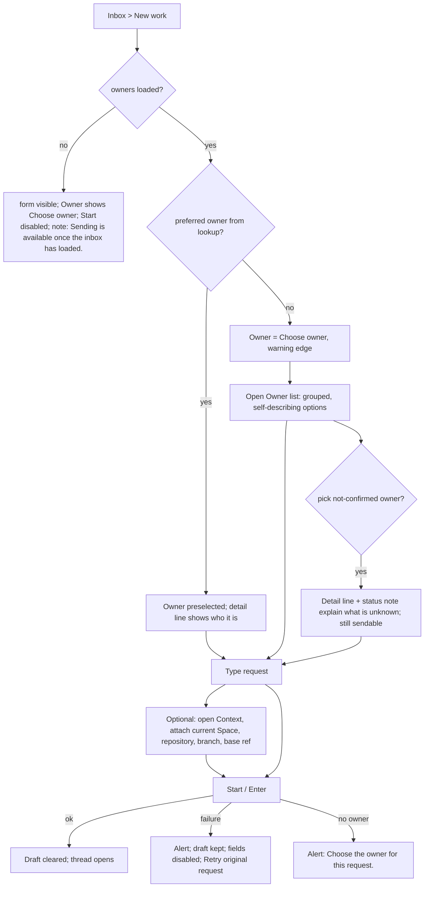

# Inbox "New work" form: design spec

Status: design only. No product code, tests or config were changed. Mockups are SVG (the only format I could rasterize and look at here; no browser or shell was available). Every mock was rasterized and inspected; fonts are fallbacks (IBM Plex Sans was not available to the renderer, so text runs slightly wider than in the product). Layout numbers come from `inbox.css` and the tokens, not from measuring a running build. Extends `research/ui-inbox-polish.md` (section 4.3 "New work") and replaces its New work layout; the rest of that spec is untouched.

## 1. Goal & users

Goal: make "New work" read as one form in one column, with an owner choice that cannot be mistaken for another owner, and without changing what any control sends.

Users: the operator starting a request with a liaison (desktop mostly, phone sometimes).

Rejected design (`/tmp/cockpit-new-work-user.png`), problems observed in the screenshot:
- Heading starts at x=368 while the composer starts at x=596: two left edges. The heading is not part of the form.
- Start floats to the right of the textarea, bottom-aligned, outside the box that holds the text.
- The Context panel is a separate slab (x=1196..1560, y=105..403) glued to the viewport edge. It reads as an unrelated block and its raw fields (Repository ID, Branch, Base ref) get the same weight as the request.
- "Attach todo" reads as "attach a todo item". `todo` is the name of the current Space (`Inbox.tsx:325` prints `Attach {Space label}`).
- Owner is a small chip above the textarea, outside the field order the user reads. Its dropdown (`/tmp/cockpit-owner-selector-user.png`) lists `Supervisor · available` and `Supervisor · unknown`: same name, no way to tell which root is which or what "unknown" means.
- Roughly 60% of the pane is empty, but the useful content is crammed into the middle.

Separate request: selected-thread lower-right seam (section 10).

Non-goals: no new field, option, route, validation or delivery behavior; no image attachment feature (section 11 only keeps room for it).

## 2. Evidence (existing patterns reused)

Behavior preserved (contract; each cites the current code, `src/app/inbox/Inbox.tsx` unless noted):
- Owner state `owner`, value is `InboxOwner.root_id`; initial value from `orchestrationLiaisonLookup` `preferred_root_id`, only if still empty (`:138`). Send fails with "Choose the owner for this request." when empty (`:253`). Options list every `view.owners` entry, label `ownerLabel · availability` (`:323`). Nothing is filtered or removed.
- `binding` sent only when a Space is attached or repository/branch/base is non-blank; values trimmed; blanks become `null` (`:269`).
- Attach checkbox: disabled when there is no current Space and none attached, or when `pending` (`:325`).
- Context fields are disabled while `pending` (`:325`). "· set" suffix when anything is set (`:325`).
- Drafts are per selection key, `new` for this screen (`:168-170`); textarea is not focused on mount (`Inbox.test.tsx:161-173`, per `research/ui-inbox-polish.md`).
- Enter sends, Shift+Enter and IME composition do not (`:331`). Textarea auto-grows to at most 40% of the window height (`:331`).
- Start button: `disabled` when view missing, session mismatch, empty text, busy, or observation not fresh (`:332`). Label `Start` in mode `new`.
- Failed or uncertain delivery keeps the draft; the send slot becomes "Retry original request"; textarea disabled (`:215`, `:331-332`, test `Inbox.test.tsx:174`).
- Notes: `role="alert"` error note (`:327`), "Sending is available once the inbox has loaded." (`:330`), hint "Enter to send · Shift+Enter for a new line", hidden under `@media (hover:none)` (`inbox.css:232`).
- Back (`:306`): `aria-label="Back to inbox"`, shown ≤700px, focus lands on it when the detail opens (`:92-94`) and returns to the origin on Back.
- Wide threshold: Context is open and "wide" when the detail container is ≥960px (`:88`, `:325`); the `details` is re-keyed on crossing it.
- Compose accent: top 2px `--mode` (= `--accent` for new) on the textarea (`inbox.css:138,226`).

Product tokens used by the mocks (`src/app/styles/tokens.css:5-55,64-68,87`): `--app-bg #0b0e12`, `--sidebar-bg #11161e`, `--chrome-bg #121923`, `--surface #161d27`, `--surface-raised #1b2431`, `--surface-selected #23354c`, `--border #2b3543`, `--border-strong #3b4758`, text `#cdd6f4/#bac2de/#a6adc8`, `--accent #89b4fa`, `--warning #f9e2af`, `--blocked #f38ba8`, `--done #94e2d5`, `--idle #a6e3a1`, font sizes `2xs 11 / control 12 / xs 13 / sm 14 / md 15 / base 16 / xl 20`, radii 4 (control) / 6 (panel), `--control-height 32`.

Existing vocabulary reused:
- Availability words `starting`, `not running`, `status unknown` (`:310`, offline owner label); `available` (`:323`).
- Duplicate-name disambiguation by `· harness` then `· …last-4-of-run-id` (`questionLabels`, `:25-29`). The owner option rule below extends the same convention.
- `.inbox-note` notice (warning edge) and `data-tone=error` (blocked edge), `.inbox-dest`/`.inbox-pick` owner pattern, `.inbox-kic` disc, `.inbox-btn`, 2px inset `--focus-strong` ring (`inbox.css:10,59-63`).
- Owner data fields available per option: `root_id, label, kind (supervisor|adopted|worker), stage (queued|starting|working|reported|active|closed), harness, availability (available|starting|absent|unknown), location (workspace_label, tab_label, pane_id)|null, undelivered` (`src/protocol/generated/v1.ts:1045-1047,1139-1141`).

Facts from the investigation (Main): the two `Supervisor` entries are two distinct roots: an available current root and an unknown stale root from a prior boot or endpoint. Both must stay selectable and routable.

## 3. Flow



## 4. Screens/components

Mockups (`research/ui-new-work/`, open in any image viewer or browser):
- `desktop-empty.svg`: 1440x900, detail pane 1100px. Default state, owner preselected.
- `desktop-populated.svg`: three-line request, Context set, Start enabled.
- `desktop-owner-open.svg`: Owner list open with three owners including the two `Supervisor`s.
- `desktop-unknown-retry.svg`: unknown owner selected, failed delivery, Retry, controls disabled.
- `mobile-states.svg`: 390x844, four frames: empty, populated with Context open, owner picker, unknown owner with failed delivery.

### 4.1 Layout (desktop, detail ≥960px)

One column, `--measure: 720px`, centred in the detail pane (`padding-inline: max(24px, calc((100% - 720px)/2))`), shared by the heading, owner, request and Context. This is the same centring the thread column already uses (`.inbox-column`, `inbox.css:196`), so heading and form share one left edge.

Top to bottom (DOM order = visual order = tab order):
1. Head: existing `.inbox-head` (32px `plus` disc, `h2 New work`, "Send a request to a liaison."), unchanged copy.
2. Owner field: visible label "Owner" (12px/500 `--text-muted`), a native `<select>` 36px high, full column width, `--surface` fill, 1px `--border-strong`, 4px radius, `user` icon at the left, chevron at the right. `aria-label="Owner"` is replaced by `<label for>` with the same word, so the accessible name does not change. Under it a 12px muted detail line (section 5).
3. Notes (only when present): owner-status note, then delivery/validation alert, then "Sending is available once the inbox has loaded." Order is DOM order. The alert keeps `role="alert"`.
4. Request box: visible label "Your request" (same words as the current `aria-label`). One bordered box (`--surface`, 1px `--border-strong`, 4px radius, 2px `--accent` top edge as today). Inside: the textarea (borderless, min-height 180px, max-height 40vh as today) and a 44px footer separated by a 1px `--border` line. Footer left: the hint text (hidden under `hover:none`, as today). Footer right: **Start** (36px high, accent fill, app-bg text, 700, `send` icon) or **Retry original request** (outlined `--warning`). Start no longer floats outside the box.
5. Context: a disclosure row ("Context · optional", `down`/`right` chevron, 13px/600 `--text-secondary`), then the helper sentence at the right of the row on one line ("Only what you set here is sent with the request."). Body is inline, not a popover and not a side panel: first row the checkbox, then a grid `repeat(auto-fit, minmax(200px, 1fr))` of Repository ID, Branch, Base ref (3 columns at 720px; wraps to 2 or 1 as the column narrows). Inputs 32px (44px on phone). Open by default when the container is ≥960px, collapsed below, as today.

Attach checkbox wording: label "Attach current Space" followed by the Space name in a small outlined chip (`todo` in the mocks). The chip is inside the `<label>`, so the accessible name is "Attach current Space todo". With no current Space the chip is absent and the control is disabled, as today. After attaching, the chip shows `attachedSpace.label` (the attached value, as today's `attachedSpace?.label || currentSpace?.label`).

### 4.2 States (desktop; phone variants in section 4.4)

| State | What changes | Mock |
| --- | --- | --- |
| Default | Owner preselected from lookup; request empty; Start disabled (35% opacity as today); Context open, fields empty | `desktop-empty.svg` |
| Populated | Request text; Start enabled; Context "· set" when any value is set; checkbox checked | `desktop-populated.svg` |
| Owner open | Native list, grouped `Available · n` and `Not confirmed · n`, first row `Choose owner` | `desktop-owner-open.svg` |
| Unknown/not-running owner selected | Detail line gets a status glyph; status note appears under it; Start stays enabled when the other conditions hold | `desktop-unknown-retry.svg` |
| Pending/failed | Owner, textarea, Context fields disabled (50%); alert above the request; Start becomes "Retry original request" | `desktop-unknown-retry.svg` |
| Not loaded | Owner shows `Choose owner` only; Start disabled; note "Sending is available once the inbox has loaded." | not mocked (existing copy) |
| No owner chosen | Owner field gets the existing warning edge (`data-empty`); after Start, alert "Choose the owner for this request." | not mocked (existing copy) |
| No owners at all | Select has only `Choose owner`; Start still enabled when text exists and returns the existing alert (no behavior change) | not mocked |

### 4.3 Owner disambiguation (the selector)

Rule for every `view.owners` entry (presentation only; value stays `root_id`; nothing filtered; no owner removed):

```
name   = ownerLabel(view, root_id)                     // existing
tail   = "…" + root_id.slice(-4)                       // existing questionLabels convention; extend to 6, 8… chars only if two tails still collide
state  = available -> "available" | starting -> "starting" | absent -> "not running" | unknown -> "status unknown"
where  = location ? `${workspace_label} › ${tab_label}` : "no live terminal"
option = [name, nameIsShared ? tail : null, state, where].join(" · ")
```

- `nameIsShared` is true when two or more owners resolve to the same `name`. A unique name gets no tail (`docs-refactor · available · docs › review`).
- The tail comes right after the name, before the state and place. The closed select (and the phone, where the closed field truncates with an ellipsis) therefore never hides the part that tells two same-named roots apart.
- Options are grouped with `<optgroup label>`: `Available · n` (availability `available`) and `Not confirmed · n` (everything else). Order inside a group is the existing `view.owners` order. `Choose owner` stays first and ungrouped.
- Examples from the mocks: `Supervisor · …a1f2 · available · todo › main`; `Supervisor · …9c3e · status unknown · no live terminal`.
- Native `<option>` text cannot carry icons or a second line. All identity is therefore in plain text; state is a word, never colour or glyph alone.

Detail line (under the field, always visible for the selected owner, 12px `--text-muted`): `{harness} · {kind} · {stage}` then `· {undelivered} undelivered` only when `undelivered > 0`, then `· root` and the full `root_id` in `--font-mono` 11px, selectable. For non-available owners the line starts with a 13px status disc (`?` for unknown; the existing `offline`/`work` shapes for not running/starting). The full id is the unambiguous identity; the 4-character tail is only a scan aid. `aria-describedby` on the select points at the detail line and the note.

Status note for a non-available selected owner (existing `.inbox-note`, `role="status"`, warning edge). Proposed copy, one per state:
- `unknown`: "Status unknown. This owner was not found on the current endpoint. You can still address it, but Cockpit cannot confirm it will read the request."
- `absent`: "This owner is not running. You can still address it, but Cockpit cannot confirm it will read the request."
- `starting`: "This owner is still starting."
The `unknown` copy's reason ("not found on the current endpoint") is [INFERENCE] from Main's finding of a stale root from a prior boot/endpoint; see open question 3.

Defaults and routing:
- Preselection is unchanged: the lookup's `preferred_root_id`, applied once and only while `owner` is empty. No auto-switch away from the user's choice when owners refresh.
- Selecting an unknown owner is allowed; Start behaves exactly as today. The design adds explanation, not a gate.
- With no preferred owner the field shows `Choose owner` with the existing warning border.
- A single owner keeps the select (no behavior change); see open question 5.

### 4.4 Phone (≤700px, same breakpoint as today)

`mobile-states.svg`. Single column, 16px gutters, page scrolls.
- Back stays 44px with `back` icon + "Inbox"; focus handoff unchanged.
- Owner select 44px; request box min-height 132px (the textarea 184px box including the 44px footer in the mock), max 40vh; Start inside the box footer (40px high, right). The hint is hidden (`hover:none`). Because Start is inside the box, which scrolls with the page, the soft keyboard cannot cover a detached Start bar and no sticky layer is needed (open question 9 compares the sticky alternative).
- Context is collapsed by default: a 44px full-width row with `right`/`down` chevron; "· set" stays. When open, helper sentence then the checkbox row (44px, 20px box) then Repository ID, Branch, Base ref stacked, inputs 44px, 16px text (the current 14px input text makes iOS Safari zoom on focus [INFERENCE: known Safari behavior, not tested here]).
- Notes wrap at the 358px measure; the full root id sits on its own line.
- The platform picker shows the same option text, wrapped, with the same optgroups.

## 5. Interaction & keyboard

- Tab order: Back (phone) → Owner → Your request → Start/Retry → Context summary → Attach checkbox → Repository ID → Branch → Base ref. Today Context sits before the textarea in the DOM; the design moves its markup below the request box so tab order equals visual order. No new shortcuts.
- Owner: native select behavior (Space/Enter/Alt+Down opens, arrows move, type-ahead matches the option text start: name first, so typing `Supervisor` jumps to the first of the two; the tail disambiguates the next press). No custom listbox.
- Request: Enter sends, Shift+Enter newline, IME composition ignored, no focus on mount, no focus steal when the owner changes.
- Context: summary toggles with Enter/Space. Open state follows the existing rule (open when the container is ≥960px); the user's own toggle is not reset by unrelated re-renders. Today the `key` re-mount resets it when crossing 960px; keep that.
- Pointer: every action is a button/control; no hover-only content.
- Focus ring: existing 2px inset `--focus-strong` on select, textarea, summary, checkbox, inputs, Start. Where the textarea is inside the box, the ring is on the textarea (not hidden by the box border).
- Pending: owner, textarea, Context fields disabled; only Retry and Back are interactive (as today).

## 6. Accessibility

- Visible labels: "Owner", "Your request", "Repository ID", "Branch", "Base ref"; the first two keep the exact words of the current `aria-label`s, so accessible names do not change (WCAG 2.5.3).
- `<optgroup label>` gives AT the grouping. The state is in the option text, so it is announced without relying on colour or on the glyph.
- Detail line and note linked via `aria-describedby`; the note is `role="status"` (polite, static text); the delivery alert keeps `role="alert"`.
- Disabled-while-pending controls use the `disabled` attribute (existing). The owner field's warning edge for "no owner" is paired with the option text `Choose owner`, not colour alone.
- Targets: select 36px desktop/44px phone; Start 36px desktop/40px phone; Context row 44px phone; checkbox row 44px phone (WCAG 2.5.8 minimum is 24px).
- Contrast (hex values from tokens; ratios computed by hand like `research/ui-inbox-polish.md` section 2, not tool-verified): `--text-muted #a6adc8` on `--surface #161d27` about 7.6:1; `--warning #f9e2af` on its 9% tint about 12:1; `--blocked #f38ba8` text is not used for body copy (the alert text is `--text-secondary`). Start: `#0b0e12` on `--accent` 9.2:1 (from the earlier spec). Disabled Start at 35% opacity is exempt as an inactive control and is explained by the empty request.
- Reflow: no horizontal scroll at 320px; `overflow-wrap:anywhere` on notes; the select truncates with an ellipsis but the full text is in the detail line and the picker.
- Not verified: screen-reader output, forced colors, 200% zoom, real touch/picker behavior.

## 7. Options considered

Owner picker:
| | A. Native select, self-describing options + detail line (recommended) | B. Radio list of all owners (cards) | C. Custom listbox with two-line rows |
| --- | --- | --- | --- |
| Distinguishes same-named roots | yes (tail, state, place in text; id in detail line) | best (all visible) | best |
| Changes control type / tests / `aria-label=Owner` select | no | yes | yes |
| Phone behavior | native picker, no code | long list pushes the request down | needs keyboard/touch/ARIA work |
| Cost | small markup + a pure formatting function | medium | high |
Recommendation A: the defect is option content, not control type. B is a reasonable follow-up if owners regularly exceed three.

Option text order: `name · tail · state · where` (recommended, truncation-safe) vs `name · state · where · tail` (reads more naturally, but the closed select can hide the tail on a phone).

Context placement:
| | Inline disclosure below the request (recommended) | Right side panel (rejected screenshot) | Popover above the dock (older code) |
| --- | --- | --- | --- |
| Shows what is sent | yes (and "· set" when closed) | yes | no until opened |
| Fits phone | yes | no | clipping at the viewport edge |
| Competes with the request | no (below, quieter) | yes | no |

Start placement: inside the request box footer (recommended) vs outside at the right (rejected). Inside makes it belong to the field and gives the attachment control a neighbour (section 11).

## 8. Open questions (options + recommendation)

1. Option text order. Options: `name · tail · state · where` / `name · state · where · tail`. Recommended: the first (truncation-safe).
2. Group labels. Options: `Available` / `Not confirmed` vs `Running` / `Other`. Recommended: `Available` / `Not confirmed` (the second group mixes starting, not running, status unknown).
3. Copy and cause for the unknown-owner note. The "not found on the current endpoint" explanation is [INFERENCE]; confirm against how `availability: "unknown"` is produced before shipping. Fallback copy: "Status unknown. You can still address this owner, but Cockpit cannot confirm it will read the request."
4. Mark the lookup's preferred owner (for example a visible "default" in the detail line). Recommended: no; it would need the lookup result kept in state, and it does not help tell roots apart beyond what the tail and state already do.
5. One owner only: keep the select (no behavior change, recommended) or show static text like `.inbox-dest`.
6. Attach label: keep `Attach {Space}` (current, ambiguous) or `Attach current Space` + name chip. Recommended: the chip form.
7. Context default: open on wide containers, collapsed below (existing, recommended) vs collapsed everywhere.
8. Location separator in option text: `›` (mock) vs `/` vs `·` (as in the direct-agent row). Recommended: `›` to keep `·` as the field separator.
9. Phone Start: inside the box (recommended, mocked) vs a sticky bottom bar. Sticky is more discoverable but covers content under the keyboard.
10. Sorting: keep `view.owners` order inside groups (recommended) vs sort by recency; the owner type has no time field.

## 9. Acceptance scenarios (observable checks in a disposable fixture)

1. 1440x900, empty: heading, Owner, request box and Context share one left edge (about 530px for a 340px list); Start is inside the request box footer; no panel at the right edge.
2. Same, owner list with two owners named `Supervisor` (one `available`, one `unknown`) plus `docs-refactor`: option texts are all different; the two Supervisors differ by tail and state; `docs-refactor` has no tail; groups read `Available · 2` and `Not confirmed · 1`; both Supervisors can be selected; sending with each uses that option's `root_id` (check the `to_run_id` of the mutation).
3. Select the unknown owner: detail line shows the status glyph, harness, kind, stage and the full root id; the status note appears; Start is enabled once text is typed; nothing else changes.
4. Pre-selected owner equals the lookup's `preferred_root_id`; changing it, then letting the inbox refresh, does not revert it.
5. With no preferred owner: `Choose owner`, warning edge; pressing Start with text shows "Choose the owner for this request." (existing).
6. Type text: Start enables; Enter sends; Shift+Enter inserts a newline; IME composition does not send; the textarea grows to at most 40% of the window.
7. Open Context, attach the Space, fill repository/branch/base: summary reads "Context · optional · set"; the mutation `binding` is `{repository_id, workspace_id, branch, base_ref}` with trimmed or null values; with all blank and no Space attached, no `binding` is sent.
8. Simulate delivery failure: alert text visible; draft retained; owner, textarea, Context fields disabled; button reads "Retry original request"; retry reuses the same message identity (existing test).
9. Inbox not loaded: note "Sending is available once the inbox has loaded." and Start disabled; owner list shows only `Choose owner`.
10. 390x844: list-or-detail as today; opening New work focuses Back; Back returns to the originating control; Owner, request, Start, Context are in one column; Context collapsed; opened fields are stacked and 44px; no horizontal scroll at 320px.
11. Keyboard only: Tab order is Back (phone) → Owner → Your request → Start → Context summary → checkbox → three fields, with the visible focus ring; the first Tab after opening does not land in a Context field before the request.
12. Screen reader pass (not verified here): Owner announces name, group and full option text; the note is announced once when the owner changes.
13. Narrow desktop (container <960px): Context collapsed; inline expansion, no popover over the textarea.
14. Regression: existing `Inbox.test.tsx` selectors (`.inbox`, `.inbox-compose`, `textarea`, `button` text `Retry original request`, drafts per key) still resolve; Main runs the affected checks.

## 10. Selected-thread lower-right seam (`/tmp/cockpit-detail-user.png`)

What the screenshot shows (1568px-wide render): the work rail (`--sidebar-bg`, x≈1195..1560) ends at y≈868. The composer dock (`--chrome-bg`) spans only the left column (x≈343..1195, y≈868..997), because `.inbox-detail:has(.inbox-rail) .inbox-compose` is `width:calc(100% - rail)` (`inbox.css:237`). The rectangle below the rail (x≈1195..1560, y≈868..1000) is bare `--app-bg`. Three surfaces (rail, dock, app background) meet at one point and the bottom-right region belongs to none of them; the rail's left border simply stops.

Ownership rule: every region of the detail pane belongs to exactly one of header, left column (content + dock) or rail; there is no leftover background; the column divider is one continuous 1px `--border` from the header's bottom edge to the pane's bottom.

Options:
- A (recommended): the rail owns its full-height right column. At ≥960px make `.inbox-detail` a two-column grid (`1fr`, `clamp(320px,30%,440px)`) with rows header / content / dock; the header spans both columns; the rail spans the content and dock rows; the dock sits in the left column only. CSS-only route: `.inbox-body{display:contents}` in that container query with explicit `grid-column`/`grid-row` on content, rail and dock, and remove the `width:calc(...)` rule on the dock. [INFERENCE: not rendered here; `display:contents` on a scroll wrapper means the content element must keep its own `overflow:auto`, which the existing container query already sets.]
- B: the dock owns the whole bottom band at full width, under the rail. The rail then ends at the dock's top border and the dock's inner padding keeps the composer aligned to the left column's 820px measure. One surface along the bottom, a plain horizontal seam, no leftover rectangle.
Recommendation: A, because the rail then behaves like the sidebar (one column, top to bottom) and the composer stays attached to the conversation it answers. B is the smaller change (delete one CSS rule, adjust padding) if grid restructuring is unwanted.

Do not leave the rail short with an empty rectangle under it; do not give the dock a different width from its column.

## 11. Room for image attachments (guidance only; separate task)

Do not implement here. The design keeps these hooks so the attachment work can slot in without a second layout change:
- The request box footer has a left slot before the hint. An attach control (icon button, 36px desktop/44px phone) goes there; the hint stays after it on desktop and stays hidden on touch. On phone the left slot is empty today (visible as free space beside Start in `mobile-states.svg`).
- Thumbnails get a strip between the textarea and the footer, inside the same bordered box, zero height when empty. Each thumbnail is a 56px square with a visible remove button and an accessible name that includes the file name.
- The whole box is the drop and paste target; the drag-over state is the box's border changing to `--accent`.
- Start stays right in the footer; its enable/disable logic (text required) is untouched by this design. Whether an image-only request may start is a product decision for the attachment task.
- Retry/pending behavior: while pending, the attach control and thumbnails are disabled like the other controls.
- The attachment error goes into the same alert slot above the request box (one alert area).

## 12. Examples (paths)

- `research/ui-new-work/desktop-empty.svg`
- `research/ui-new-work/desktop-populated.svg`
- `research/ui-new-work/desktop-owner-open.svg`
- `research/ui-new-work/desktop-unknown-retry.svg`
- `research/ui-new-work/mobile-states.svg`
- This spec: `research/ui-new-work-design.md`

Implementation notes for the implementer (no code written here):
- Markup deltas: wrap textarea + footer (hint, Start/Retry) in one `.inbox-box` for mode `new`; render the Owner field as a labelled block before the notes in mode `new`; move `.inbox-ctx` after the box; add the `ownerOptions(view.owners)` formatter next to `ownerLabel` (pure function, easy to unit-test: unique names, shared names, tail collisions, null location, each availability) and the detail line.
- CSS: `--measure:720px`; `.inbox-content.is-new` and `.inbox-compose[data-mode=new]` use the same `padding-inline`; drop the `position:absolute` Context rules at `inbox.css:143,238-242`; context grid `repeat(auto-fit,minmax(200px,1fr))`; inputs 16px text on `(pointer:coarse)`.
- Remove the obsolete popover/side-panel rules and the duplicated `textarea` min-height rules (`inbox.css:144,174,226,231`) in the same change.
